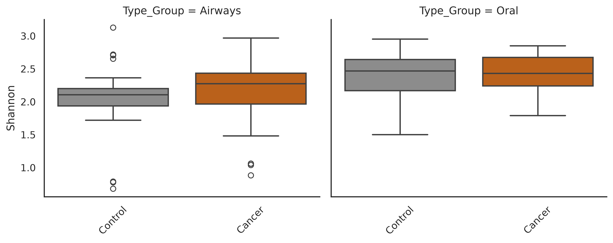
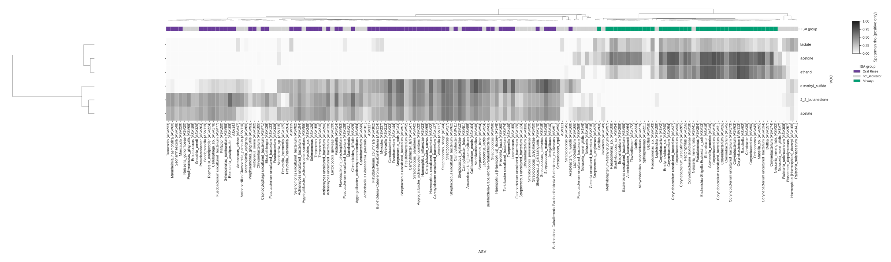

# From airway reads to patient-level associations

Can a respiratory microbiome workflow recover signals planted in a community with repeated sampling, skin controls and extraction blanks? In this vignette you will process paired V4 reads, follow the controls through filtering, and explore which microbial and chemical associations survive patient-level analysis.

```{contents} In this vignette
:local:
:depth: 2
```

## Set up ASPIRE main

Use a 64-bit Linux machine with Git, Python 3 and Mamba on PATH. Budget at least 8 cores, 32 GB RAM and 50 GB of free storage. The first launch requires internet access for environments and taxonomy references. See [installation](installation.md) for prerequisites.

```bash
mkdir -p ~/aspire-vignette
cd ~/aspire-vignette
WORK="$PWD"
git clone --branch main https://github.com/hallamlab/ASPIRE.git
cd ASPIRE
git rev-parse HEAD > "$WORK/aspire-revision.txt"
```

Keep this shell open for the commands below. For an existing checkout, set `WORK` to an absolute analysis directory and run the ASPIRE commands from the repository root.

## Obtain the study

Zenodo deposition is pending. The prepared archive is approximately 2.4 GiB (SHA-256 `a3c87a6ec68113605742cf44de9bc70ea328edd07c05d1dbf321bab56eeef3dc`). If you have the vignette distribution, place `aspire-cami-mock-v1.tar.gz` and its `.sha256` companion in the analysis directory and run:

```bash
(cd "$WORK" && sha256sum -c aspire-cami-mock-v1.tar.gz.sha256 && tar -xzf aspire-cami-mock-v1.tar.gz)
DATASET="$WORK/mock_dataset"
```

You can also generate the study now using the [DECOI CAMI2 body-site instructions](https://hallamlab-decoi.readthedocs.io/en/latest/cami-body-sites.html). Set `DATASET` to the resulting absolute `dataset/mock_dataset` directory. Both routes supply the same input layout.

DECOI simulated 50 patients using CAMI2-derived communities, synthetic chemistry and seed 42. Each of 25 controls contributes one airway, one oral and one skin library. Each of 25 cases contributes two airway libraries (tumor-side and contralateral), one oral and one skin library. Four extraction blanks bring the total to 179. The 50 skin libraries serve as biological controls. Oral and airway libraries form the 125-sample analysis cohort.

```bash
head -n 3 "$DATASET/fastq_manifest.tsv"
head -n 2 "$DATASET/sample_metadata.tsv"
head -n 2 "$DATASET/chemistry.tsv"
```

Follow one sample ID from its R1/R2 paths to its participant, body site and chemistry. Retain the `ground_truth_*.tsv` tables for evaluation after inference. They describe the planted features, group effects, chemical associations and network modules.

## Configure, run and validate

```bash
RESULTS="$WORK/results"
CONFIG="$WORK/cami.yml"
./examples/configure_mock_run.sh --dataset "$DATASET" --output "$RESULTS" --config-out "$CONFIG" --threads 8
./run_asv_pipeline.sh "$CONFIG"
./examples/validate_mock_run.sh --dataset "$DATASET" --results "$RESULTS" > "$WORK/validation.txt"
cat "$WORK/validation.txt"
```

The configurator writes machine-local paths and selects the CAMI clinical profile. Review the generated YAML for primer trimming, biological and technical control definitions, patient column and VOC table. Its current large-study power settings use 1,000 simulations and 999 permutations. To resume, repeat the launcher with the same YAML and retain the results directory and its hidden runtime cache.

Open `summary/report/ASPIRE_run_report.html` inside the results directory. Use the module links to move between figures, source tables and execution logs. For a remote run, see [report viewing](outputs.md#view-reports-on-a-remote-server). The examples below use the saved Cutadapt run, which completed or reused 931 tasks. Numerical values describe that run and can vary with revisions and analysis settings.

## Follow the reads through filtering

The primer audit accounted for all 8,802,765 input pairs. Cutadapt trimmed 8,789,619 pairs with the 515F/806R family and classified 13,146 as unmatched. After fastp, sequence inference and chimera removal, the raw count table contained 498 ASVs. Look at `modules/primer_trimming/tables/primer_cohort.json` for per-library counts.

The 5,000-read biological depth threshold retained all 125 airway and oral libraries. Technical controls flagged 104 ASVs and skin controls flagged 81. Twelve appeared in both lists, so their union removed 173. ASPIRE then screened non-targets and required at least 0.1% relative abundance in one biological sample and nonzero counts in at least 5% of the cohort (seven samples). The final table contained **185 ASVs across 125 libraries**. All four planted non-target features were identified. Inspect the per-feature decisions alongside the count matrix:

```bash
head -n 3 "$RESULTS/modules/non_target_filtering/tables/ASV_target.feature_qc.tsv"
head -n 1 "$RESULTS/modules/non_target_filtering/tables/ASV_target.tsv" | cut -f1-5
```

## Compare community diversity across patients

Start with Shannon diversity within libraries. Read the case and control distributions within each sample type. Each patient contributes several libraries, so a patient-level comparison needs to account for repeated sampling.



```bash
DIV="$RESULTS/modules/diversity/tables/patient_aware"
cat "$DIV/bray_permanova_case_patient_pooled.tsv"
head "$DIV/bray_permdisp_diagnostics.tsv"
```

The pooled Bray–Curtis PERMANOVA used 25 cases and 25 controls. Case status explained 3.3% of variation (permutation p = 0.128), giving limited evidence for an overall case effect. Examine dispersion diagnostics and the sample-type-specific tables before attributing separation in an ordination to disease group.

### Examine lung side and statistical power

Open `modules/lung_status_analysis/tables/Airways/lung_status_contrasts_summary.tsv` for the airway-specific contrasts. Use `patient_level_metadata.tsv` in the same directory to distinguish paired tumor-side and contralateral observations from independent control patients.

For a planning question, inspect `modules/power_analysis/tables/power_summary_cancer_vs_control.tsv`. In the saved run, airway PERMANOVA power at the reported grid point of 10 was 0.060, and the 80% target was beyond the tested range. This is a simulation under this mock’s effect sizes and settings. A fresh configuration uses a wider grid and more permutations. Use its own power table to interpret a new run.

## Explore indicator taxa and VOC associations

Look up an ASV in `modules/taxonomy/tables/ASV_SILVA_tax.full-length.vsearch.tsv` to read its assigned lineage and consensus. The saved run assigned taxonomy to 497 of 498 inferred ASVs. To trace the abundances supplied downstream, inspect the before-correction, after-correction and selected CLR tables in `modules/batch_correction/tables/`.

Open `modules/indicator_analysis/tables/Case_indicator_species_results.tsv` and inspect the group columns, indicator statistic and permutation p-value. The validator maps inferred features to simulated sequences and found 22 of the 48 planted indicator ASVs across the evaluated indicator analyses. ASV numbers are assigned within each run.



Use the heatmap to select a candidate, then check the patient-level estimate, sample support, normalization and multiple-testing adjustment. This command lists the five tested relative-abundance associations with the lowest adjusted p-values:

```bash
python3 - "$RESULTS/modules/voc_correlation/tables/patient_asv_voc_permutation_long.tsv" <<'PY'
import csv
import sys
with open(sys.argv[1]) as source:
    rows = [r for r in csv.DictReader(source, delimiter="\t")
            if r["normalization"] == "relative_abundance" and r["status"] == "tested"]
for row in sorted(rows, key=lambda r: float(r["q_value"]))[:5]:
    print(*(row[k] for k in ("asv_label", "voc", "n_patients", "rho", "q_value")), sep="\t")
PY
```

For example, ASV295 (assigned to *Massilia*) and acetone had a positive patient-level association (50 patients, Spearman rho = 0.669, adjusted p = 0.0104). This measures covariation in synthetic patients. Across the separate sample-level truth check, six of 17 planted positive ASV–VOC pairs reached the validator’s Spearman rho threshold of 0.30. See [VOC statistics](VOC_STATISTICS.md) for normalization and permutation details.

## Explore network structure and assess recovery

```bash
NET="$RESULTS/modules/network_analysis/tables"
head "$NET/spieceasi_edge_list.csv"
head "$NET/spieceasi_modules_all.tsv"
cat "$NET/network_topology_summary.tsv"
```

Select an edge, locate both ASVs in the module table, and inspect their positions in the network plot or open `spieceasi_network_pos_thr.graphml` in a graph viewer. The saved network had 1,192 edges and a largest module of 42 ASVs. Four inferred edges connected members of the same planted module. A shared module indicates a statistical pattern in these simulated abundances. Direct microbial interaction would require separate evidence.

Finish with the validator’s `indicator_analysis`, `voc_correlation`, `network_analysis` and `manifest_integrity` lines. The saved run passed all 31 checks, including primer accounting and output hashes. The {download}`Cutadapt validation log <../examples/benchmarks/aspire-cami-mock/cutadapt-validation.txt>` records the recovery checks. The earlier fixed-clipping benchmark retained 221 ASVs and has its own {download}`provenance record <../examples/benchmarks/aspire-cami-mock/provenance.json>`. Genome linkage requires separate genome inputs and is outside this amplicon dataset.
