# From airway reads to patient-level associations

Can a respiratory microbiome workflow recover signals planted in a community with repeated sampling, skin controls and extraction blanks? In this vignette you will process paired V4 reads, follow the controls through filtering, and explore which microbial and chemical associations survive patient-level analysis.

```{contents} In this vignette
:local:
:depth: 2
```

## Set up ASPIRE main

Use a 64-bit Linux machine with Git, Python 3 and Mamba on PATH. Budget at least 8 cores, 32 GB RAM and 50 GB of free storage. The first launch requires internet access for environments and taxonomy references. See [installation](installation.md) for prerequisites.

```bash
(
set -euo pipefail
WORK="$HOME/aspire-vignette"
mkdir -p "$WORK"
cd "$WORK"
if [[ ! -e ASPIRE ]]; then
    git clone --branch main https://github.com/hallamlab/ASPIRE.git ASPIRE
fi
cd "$WORK/ASPIRE"
if [[ "$(git branch --show-current)" != main ]]; then
    echo "Expected the ASPIRE main checkout in $PWD. Check the branch before continuing." >&2
    exit 1
fi
git pull --ff-only origin main
git rev-parse HEAD > "$WORK/aspire-revision.txt"
)
```

Paste each Bash block as a unit, in order. Each starts from an explicit directory under `~/aspire-vignette` and returns to your starting directory when it finishes. You can open a fresh Bash shell between steps.

## Obtain the study

Zenodo deposition is pending. The prepared archive is approximately 2.4 GiB (SHA-256 `a3c87a6ec68113605742cf44de9bc70ea328edd07c05d1dbf321bab56eeef3dc`). Download or copy both `aspire-cami-mock-v1.tar.gz` and `aspire-cami-mock-v1.tar.gz.sha256` to `~/Downloads` or `~/aspire-vignette`. This block verifies the archive before extracting it into `~/aspire-vignette/mock_dataset`.

```bash
(
set -euo pipefail
WORK="$HOME/aspire-vignette"
mkdir -p "$WORK"
cd "$WORK"
archive=aspire-cami-mock-v1.tar.gz
if [[ ! -f "$archive" || ! -f "$archive.sha256" ]]; then
    if [[ ! -f "$HOME/Downloads/$archive" || ! -f "$HOME/Downloads/$archive.sha256" ]]; then
        echo "Place $archive and $archive.sha256 together in $WORK or $HOME/Downloads, then repeat this block." >&2
        exit 1
    fi
    cd "$HOME/Downloads"
fi
sha256sum -c "$archive.sha256"
tar -xzf "$archive" -C "$WORK"
cd "$WORK/mock_dataset"
ls fastq_manifest.tsv sample_metadata.tsv chemistry.tsv
)
```

You can also generate the study now using the [DECOI CAMI2 body-site instructions](https://hallamlab-decoi.readthedocs.io/en/latest/cami-body-sites.html). For that route, skip the archive block and copy the resulting `mock_dataset` directory into `~/aspire-vignette/` before continuing. Both routes use `~/aspire-vignette/mock_dataset/fastq_manifest.tsv`.

DECOI simulated 50 patients using CAMI2-derived communities, synthetic chemistry and seed 42. Each of 25 controls contributes one airway, one oral and one skin library. Each of 25 cases contributes two airway libraries (tumor-side and contralateral), one oral and one skin library. Four extraction blanks bring the total to 179. The 50 skin libraries serve as biological controls. Oral and airway libraries form the 125-sample analysis cohort.

```bash
(
set -euo pipefail
cd "$HOME/aspire-vignette/mock_dataset"
head -n 3 fastq_manifest.tsv
head -n 2 sample_metadata.tsv
head -n 2 chemistry.tsv
)
```

Follow one sample ID from its R1/R2 paths to its participant, body site and chemistry. Retain the `ground_truth_*.tsv` tables for evaluation after inference. They describe the planted features, group effects, chemical associations and network modules.

## Configure, run and validate

```bash
(
set -euo pipefail
WORK="$HOME/aspire-vignette"
cd "$WORK/ASPIRE"
DATASET="$WORK/mock_dataset"
RESULTS="$WORK/results"
CONFIG="$WORK/cami.yml"
./examples/configure_mock_run.sh --dataset "$DATASET" --output "$RESULTS" --config-out "$CONFIG" --threads 8
./run_asv_pipeline.sh "$CONFIG"
./examples/validate_mock_run.sh --dataset "$DATASET" --results "$RESULTS" 2>&1 | tee "$WORK/validation.txt"
)
```

The configurator writes machine-local paths and selects the CAMI clinical profile. Review the generated YAML for primer trimming, biological and technical control definitions, patient column and VOC table. Its current large-study power settings use 1,000 simulations and 999 permutations. To resume, repeat the launcher with the same YAML and retain the results directory and its hidden runtime cache.

Open `~/aspire-vignette/results/summary/report/ASPIRE_run_report.html`. Use the module links to move between figures, source tables and execution logs. For a remote run, see [report viewing](outputs.md#view-reports-on-a-remote-server). The examples below use the saved Cutadapt run, which completed or reused 931 tasks. Numerical values describe that run and can vary with revisions and analysis settings.

### Read the HTML report


Start with **Data Accounting Summary**. The 125 samples tile counts analyzed libraries. The 50 participants tile counts people. Read the Case table horizontally: 75 case libraries came from 25 cases because each case supplied two airway samples and one oral sample to the analysis. The 17,605,530 input read records count both mates of 8,802,765 pairs.


Scroll to **Output Inventory**. In the Diversity card, **Plots** opens the published figures and **Tables** opens the numerical results. File counts include multiple export formats. Use the same pair of links in Taxonomy, Network Analysis and VOC Correlation to explore those results. The screenshots show the saved report; the grayscale study panels below are drawn from its module tables.

## Make the study figures from your run

ASPIRE publishes individual plots under `$RESULTS/modules/<module>/plots/`. For a SPARK-style review of the CAMI mock, paste the block below after validation. It creates a plotting environment, collects native plots and draws additional panels directly from your published tables. You can open the SVGs in a browser or edit them individually in a vector editor.

```bash
(
set -euo pipefail
WORK="$HOME/aspire-vignette"
cd "$WORK/ASPIRE"
RESULTS="$WORK/results"
mamba create -y -n aspire-vignette-figures -c conda-forge python=3.11 matplotlib pandas numpy 'scipy>=1.11' networkx
mamba run -n aspire-vignette-figures python examples/benchmarks/aspire-cami-mock/render_study_figures.py "$RESULTS" "$WORK/study-figures"
)
```

The study-figures directory includes the interactive read-flow HTML, SVGs, the tables behind the newly drawn panels, and the heatmap column order. The companion command below also reproduces the collector, Shannon and ordination, VOC, module-size and airway-phylum panels in this walkthrough.

```bash
(
set -euo pipefail
WORK="$HOME/aspire-vignette"
cd "$WORK/ASPIRE"
RESULTS="$WORK/results"
mamba run -n aspire-vignette-figures python examples/benchmarks/aspire-cami-mock/render_vignette.py "$RESULTS" "$WORK/study-figures"
)
```

SPARK used oral rinse, BAL and bronchial brush samples, and documented separate pre- and post-host-exclusion stages. This walkthrough follows the mock’s airway/oral design. In particular, the read-flow panel spans processing stages, the overlap and site-specific case tests use final features, and the network shows only its modeled subset.

## Follow the reads through filtering

The primer audit accounted for all 8,802,765 input pairs. Cutadapt trimmed 8,789,619 pairs with the 515F/806R family and classified 13,146 as unmatched. After fastp, sequence inference and chimera removal, the raw count table contained 498 ASVs. Look at `modules/primer_trimming/tables/primer_cohort.json` for per-library counts.

The 5,000-read biological depth threshold retained all 125 airway and oral libraries. Technical controls flagged 104 ASVs and skin controls flagged 81. Twelve appeared in both lists, so their union removed 173. ASPIRE then screened non-targets and required at least 0.1% relative abundance in one biological sample and nonzero counts in at least 5% of the cohort (seven samples). The final table contained **185 ASVs across 125 libraries**. All four planted non-target features were identified. Inspect the per-feature decisions alongside the count matrix:

```bash
(
set -euo pipefail
cd "$HOME/aspire-vignette/results/modules/non_target_filtering/tables"
head -n 3 ASV_target.feature_qc.tsv
head -n 1 ASV_target.tsv | cut -f1-5
)
```

Read a row in `ASV_target.feature_qc.tsv` before opening a community plot. ASV10 occurred in 56 of 125 eligible libraries (44.8%), reached 18.32% relative abundance in its most abundant library, and passed both filters. Its maximum abundance describes one library; its prevalence describes the cohort.

[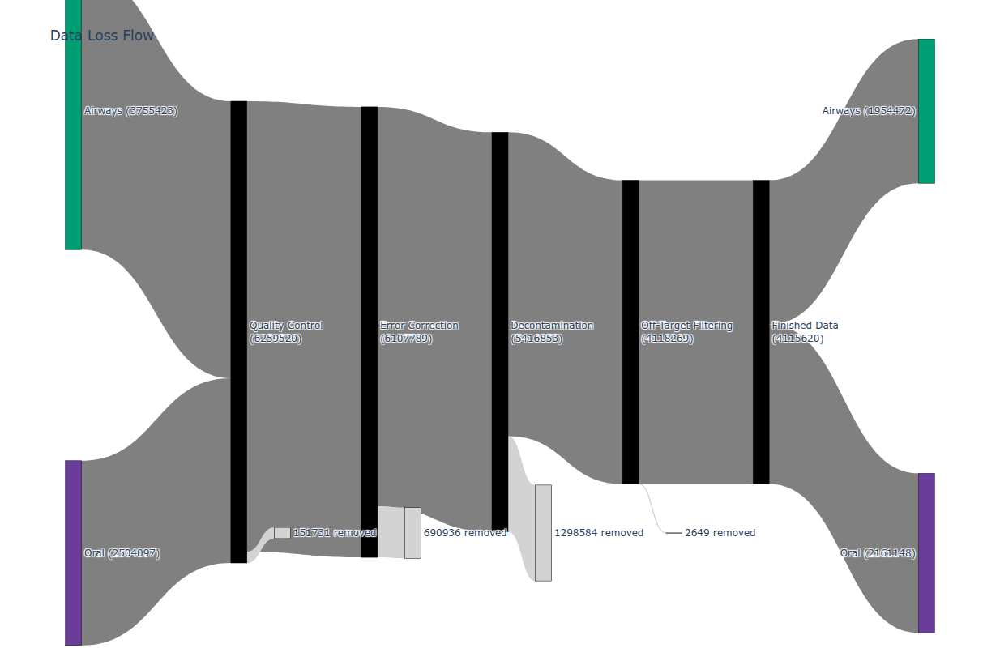](assets/vignette/mock-read-flow.png)

Open `data_loss_sankey.label.html` in the study-figures directory and hover over a flow to read its value. Next, inspect the [read-depth plot by control class](assets/vignette/read_depth_by_class.svg). It helps explain why the four extraction blanks can contribute control evidence even though biological libraries must pass a depth threshold.

| Exclusive intersections | Presence by site |
| --- | --- |
| [](assets/vignette/final_micro_upset.svg) | [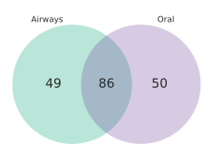](assets/vignette/site-overlap.svg) |

The regions count ASVs: 49 occurred only in airway libraries, 86 occurred at both sites, and 50 occurred only in oral libraries. Their sum gives the 185 final ASVs. Circle areas are schematic. Follow an individual ASV in `modules/upset/tables/final_micro_final_venn_presence_table.tsv`.

### How quickly do the two sites accumulate features?


Follow each line from left to right as libraries accumulate. The shading spans the 2.5th to 97.5th percentile in `modules/collectors_curve/tables/{Airways,Oral}_collector_stats.tsv`. At the last point every library from that site is included, so the band closes. Check the endpoint against `collectors_curve_summary.tsv`:

| Site | Libraries | ASVs observed at the endpoint |
| --- | ---: | ---: |
| Airways | 75 | 115 |
| Oral | 50 | 130 |

Compare the curves at the same number of libraries when assessing sampling effort. A feature can occur at both sites, so adding the endpoints would count shared ASVs twice.

## Compare community diversity across patients

Start with Shannon diversity within libraries. Read the case and control distributions within each sample type. Each patient contributes several libraries, so a patient-level comparison needs to account for repeated sampling.


On the left, the center line marks median Shannon diversity and the box spans the middle half of libraries. On the right, each point is a library, circles are airway samples and triangles are oral samples. Nearby points have similar profiles in this embedding. Locate a point by its coordinates in `modules/diversity/tables/umap_coordinates_bray.tsv`, then follow its `Participant_ID` across sites. Use the PERMANOVA table below for the patient-level test. [Original Shannon plot](assets/vignette/alpha_faceted_Shannon_Case.png)

```bash
(
set -euo pipefail
cd "$HOME/aspire-vignette/results/modules/diversity/tables/patient_aware"
cat bray_permanova_case_patient_pooled.tsv
head bray_permdisp_diagnostics.tsv
)
```

The pooled Bray–Curtis PERMANOVA used 25 cases and 25 controls. Case status explained 3.3% of variation (permutation p = 0.128), giving limited evidence for an overall case effect. Examine dispersion diagnostics and the sample-type-specific tables before attributing separation in an ordination to disease group.

Open the [within-patient Bray–Curtis distance plot](assets/vignette/Bray_Boxplot_sample_type_within_patient.svg) alongside the ordination. The plot describes distances between paired samples; UMAP places individual libraries in two dimensions.

### Examine lung side and statistical power

Open `modules/lung_status_analysis/tables/Airways/lung_status_contrasts_summary.tsv` for the airway-specific contrasts. Use `patient_level_metadata.tsv` in the same directory to distinguish paired tumor-side and contralateral observations from independent control patients.

Read across each row before comparing p-values. The paired contrast tests differences within a patient, while each comparison to healthy airways uses different patients.

| Airway contrast | Patients | Libraries | Bray–Curtis R² | Adjusted p | Shannon adjusted p |
| --- | ---: | ---: | ---: | ---: | ---: |
| Tumor-side vs contralateral | 25 | 50 | 0.0145 | 0.003 | 0.914 |
| Contralateral vs healthy | 50 | 50 | 0.0280 | 0.250 | 0.355 |
| Tumor-side vs healthy | 50 | 50 | 0.0268 | 0.250 | 0.355 |

The paired test detects a small community-composition difference despite similar Shannon medians (2.29 and 2.27). Read `permanova_q` for the adjusted composition test and `alpha_q` for the adjusted within-library diversity test.

For a planning question, inspect `modules/power_analysis/tables/power_summary_cancer_vs_control.tsv`. In the saved run, airway PERMANOVA power at the reported grid point of 10 was 0.060, and the 80% target was beyond the tested range. This is a simulation under this mock’s effect sizes and settings. A fresh configuration uses a wider grid and more permutations. Use its own power table to interpret a new run.

| Lung-side contrasts | Power by sample size |
| --- | --- |
| [](assets/vignette/Distance_contrasts_ABC.svg) | [](assets/vignette/power_curves_cancer_vs_control_simple.svg) |

Use the contrast table above to recover the patient denominator for each distance comparison. On the power plot, follow one scenario as sample size changes; the saved mock covers a shorter grid than new runs.

## Trace taxonomic abundance across patients

[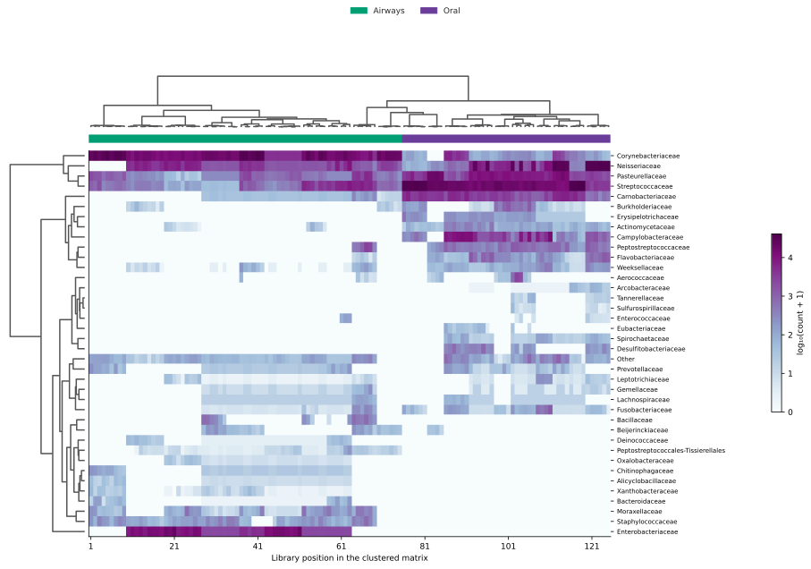](assets/vignette/family-patient-heatmap.svg)

Each column is a library. Columns are grouped by case status and patient; the strip identifies airway and oral samples. Each row is a family. Darker cells indicate larger log₁₀(count + 1) values. Ward clustering orders the rows. To identify a dark cell, use `family-patient-heatmap.tsv` and look up its column in `heatmap-column-order.tsv`. The [phylum heatmap](assets/vignette/phylum-patient-heatmap.svg) preserves the same library order at a broader taxonomic rank.

| Phylum composition by site | Family abundance across patients |
| --- | --- |
| [](assets/vignette/phylum-composition.svg) | [](assets/vignette/family-abundance.svg) |

The composition plot gives each library equal weight. Actinobacteriota accounts for 58.9% of mean airway composition and 2.1% of mean oral composition in the saved clustermap matrix. The family plot uses a different unit: it averages a patient's library proportions within each site before drawing boxplots for the ten families with the highest overall mean library proportion. The exported TSV includes all patient values, including observations outside the displayed whiskers.

## Explore indicator taxa and VOC associations

Look up an ASV in `modules/taxonomy/tables/ASV_SILVA_tax.full-length.vsearch.tsv` to read its assigned lineage and consensus. The saved run assigned taxonomy to 497 of 498 inferred ASVs. To trace the abundances supplied downstream, inspect the before-correction, after-correction and selected CLR tables in `modules/batch_correction/tables/`.

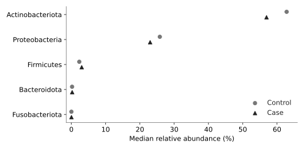

The dots compare the five phyla with the largest airway median in either group. Open `modules/taxonomy/tables/cancer_vs_control/taxonomic_abundance_observed.tsv` and select the Airways, Phylum, Actinobacteriota row. Multiply the median fractions by 100 to recover the plotted positions: 56.94% for cases and 62.81% for controls. The difference is −5.87 percentage points, with adjusted p = 0.793. The spacing of those two symbols describes the observed effect; the table supplies its statistical test.

Open `modules/indicator_analysis/tables/Case_indicator_species_results.tsv` and inspect the group columns, indicator statistic and permutation p-value. The validator maps inferred features to simulated sequences and found 22 of the 48 planted indicator ASVs across the evaluated indicator analyses. ASV numbers are assigned within each run.

For an indicator example, find ASV14 in `Case_indicator_species_summary.tsv` in the same directory. The selected Control group has `s.Control = 1`, the indicator statistic is 0.859, and the adjusted p-value is 0.002. Use sequence identity to compare this indicator with the planted truth in a different run.

### Read the indicator species analysis (ISA) plots

| A · Sample-type indicators | B · Case-status indicators |
| --- | --- |
| [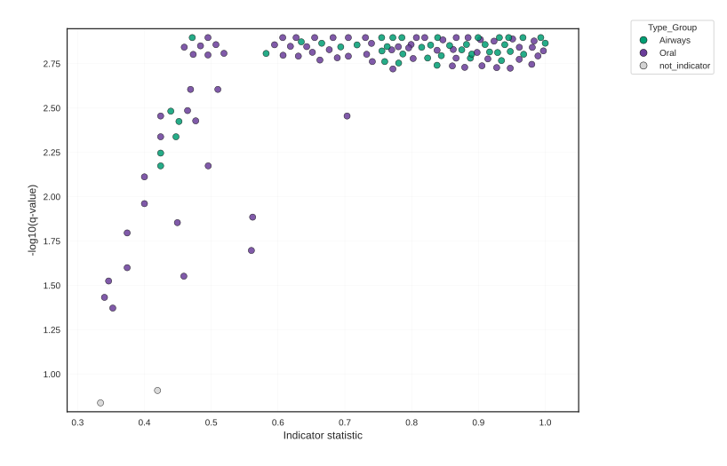](assets/vignette/type_group_ISA_plot.svg) | [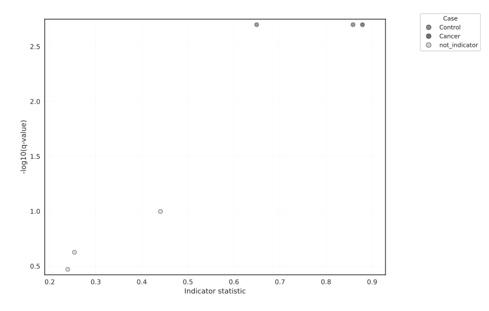](assets/vignette/case_ISA_plot.svg) |

Each point represents an ASV. Read rightward for a stronger indicator statistic and upward for a smaller adjusted p-value. A height of 2 corresponds to q = 0.01. Overlapping marks are spread for visibility. Use the tables for exact coordinates. The saved run called 119 sample-type indicators and three case-status indicators across the two analyses; an ASV can contribute to both counts. Select any panel to enlarge its vector artwork.

| C · Case statistic by sample type | D · Case statistic by phylum |
| --- | --- |
| [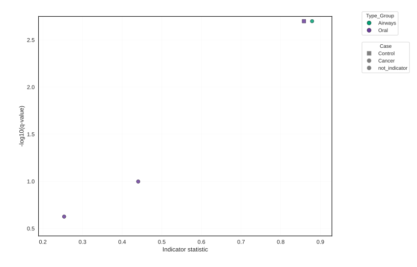](assets/vignette/Combined_ISA_plot.svg) | [](assets/vignette/Combined_ISA_plot_Phylum.svg) |

C and D use the **case-status** statistic and adjusted p-value for both axes. Marker shape identifies the case-status assignment. Hue in C gives the sample-type assignment; hue in D gives the phylum. Use the legend for each panel. For a phylum view on the **sample-type** axes, open the [sample-type ISA plot by phylum](assets/vignette/type_group_ISA_plot_Phylum.svg).

Trace ASV10 through `modules/indicator_analysis/tables/Type_Group__Case/Combined_ISA_with_taxonomy.tsv`. Its sample-type statistic is 0.999, q = 0.00127, and its label is Oral (purple in A). Its phylum is Firmicutes. Its case-statistic fields are empty, so its strong oral association does not yield a point on the case-statistic axes.

### Compare the same indicators by site and phylum

| Sample-type assignment | Phylum assignment |
| --- | --- |
| [](assets/vignette/type_group_ISA_plot.svg) | [](assets/vignette/type_group_ISA_plot_Phylum.svg) |

This pair keeps the sample-type axes fixed. ASV10 is the oral-associated Firmicutes example in both views. Use `type_group_ISA_with_taxonomy.tsv` for its exact position and taxonomic assignment.

[](assets/vignette/indicator-partitions.svg)

Allowing group combinations yielded 43 airway and 76 oral indicators. Restricting the model to single groups yielded 49 and 87. Neither fit reported a significant Airways + Oral assignment. Each bar counts significant entries in the corresponding Type_Group summary; overlapping model results should not be added together.

### Compare indicators with chemical measurements


Read down the acetone column. ASV295 and ASV173 have positive coefficients, while ASV66 has a negative coefficient. Read across any row to compare compounds for the same ASV. Blue shows negative and rust shows positive associations on a common −1 to +1 scale. Cell labels give rho; adjusted p-values appear in the permutation table. These three rows illustrate the patient-level relative-abundance analysis. [Full sample-level clustermap from the report](assets/vignette/asv_voc_clustermap.svg)

Use the heatmap to select a candidate, then check the patient-level estimate, sample support, normalization and multiple-testing adjustment. This command lists the five tested relative-abundance associations with the lowest adjusted p-values:

```bash
(
set -euo pipefail
cd "$HOME/aspire-vignette/results/modules/voc_correlation/tables"
python3 - "patient_asv_voc_permutation_long.tsv" <<'PY'
import csv
import sys
with open(sys.argv[1]) as source:
    rows = [r for r in csv.DictReader(source, delimiter="\t")
            if r["normalization"] == "relative_abundance" and r["status"] == "tested"]
for row in sorted(rows, key=lambda r: float(r["q_value"]))[:5]:
    print(*(row[k] for k in ("asv_label", "voc", "n_patients", "rho", "q_value")), sep="\t")
PY
)
```

For example, ASV295 (assigned to *Massilia*) and acetone had a positive patient-level association (50 patients, Spearman rho = 0.669, adjusted p = 0.0104). This measures covariation in synthetic patients. Across the separate sample-level truth check, six of 17 planted positive ASV–VOC pairs reached the validator’s Spearman rho threshold of 0.30. See [VOC statistics](VOC_STATISTICS.md) for normalization and permutation details.

## Explore network structure and assess recovery

```bash
(
set -euo pipefail
cd "$HOME/aspire-vignette/results/modules/network_analysis/tables"
head spieceasi_edge_list.csv
head spieceasi_modules_all.tsv
cat network_topology_summary.tsv
)
```


Start with the published degree plot to locate highly connected nodes. Use `spieceasi_node_features.csv` for an exact value: ASV10 has 13 neighbors in the thresholded graph. In the edge list, ASV10 connects to ASV125 with weight 0.0341. Looking both up in `spieceasi_modules_all.tsv` places ASV10 in M1 and ASV125 in M9. An edge can cross a module boundary.

### Interpret the network color panels

| A · Sample-type ISA | B · Case-status ISA |
| --- | --- |
| [](assets/vignette/network_Type_Group_ISA.svg) | [](assets/vignette/network_Case_ISA.svg) |

**Which groups do connected ASVs indicate?** A uses green for airway indicators and purple for oral indicators. B uses gray for Non-Cancer and orange for Cancer. Node size encodes indicator strength. Follow ASV10 from the oral indicator table into A; use the labeled SVG in the run’s plots directory to locate it. For gray nodes in B, consult the case summary to distinguish an assigned control indicator from a background node.

| C · Phylum and indicator strength | D · Phylum and mean abundance |
| --- | --- |
| [](assets/vignette/network_phylum_ISA.svg) | [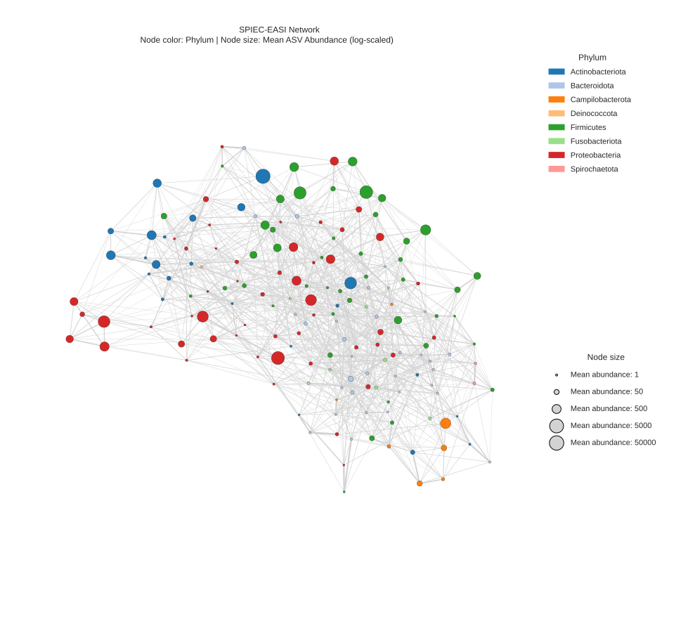](assets/vignette/network_phylum_ABUND_MEAN.svg) |

**Is a strong indicator also abundant?** Hue identifies phylum in C and D. Size changes from indicator strength to log-scaled mean abundance. Compare relative prominence within each panel using its size legend. The default `network_phylum_ABUND.svg` also shows the mean-abundance view.

| E · Phylum and median abundance | F · Betweenness class and degree |
| --- | --- |
| [](assets/vignette/network_phylum_ABUND_MEDIAN.svg) | [](assets/vignette/network_betweenness_POS_ALL.svg) |

**How typical or structurally central is the ASV?** Compare E with D: a node prominent by mean but small by median warrants inspecting the distribution of its counts across libraries. In F, hue marks normalized betweenness at or above versus below 0.05; size gives degree. In `spieceasi_node_features.csv`, ASV10 has degree 13 and normalized betweenness 0.0435, placing it below that threshold.

| G · ISA-associated modules, POS_ALL | H · ISA-associated modules, POS_SUB |
| --- | --- |
| [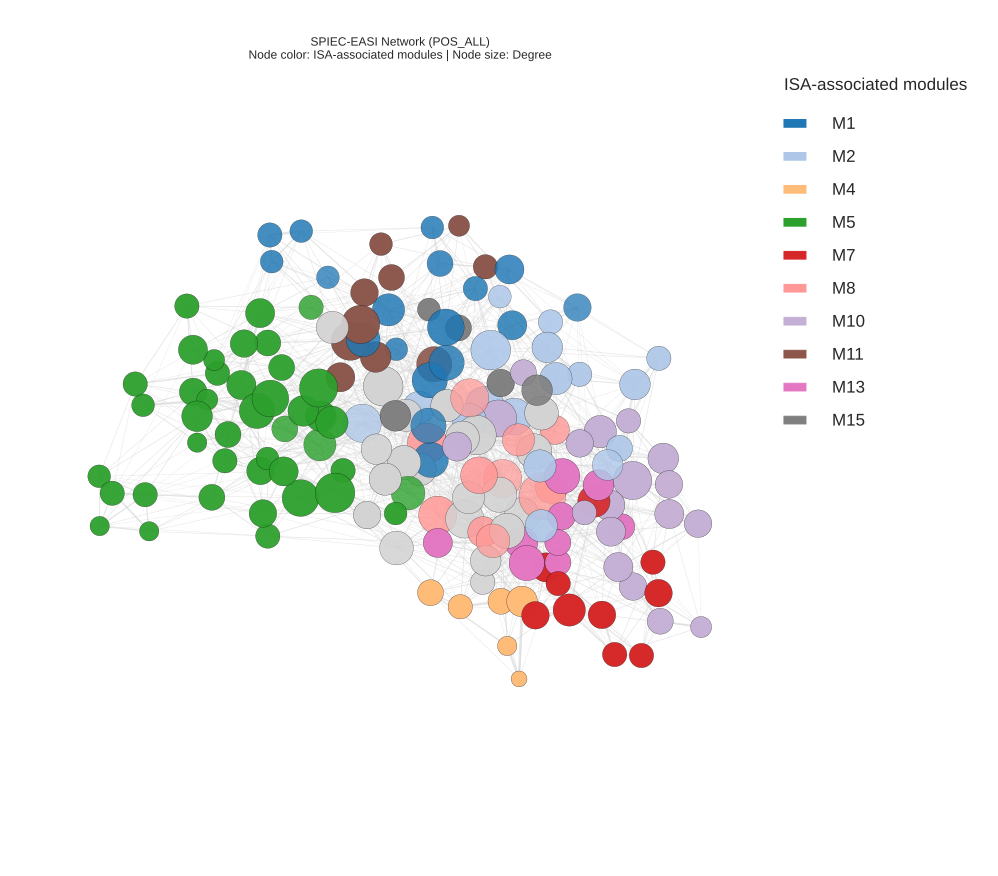](assets/vignette/network_modules_POS_ALL.svg) | [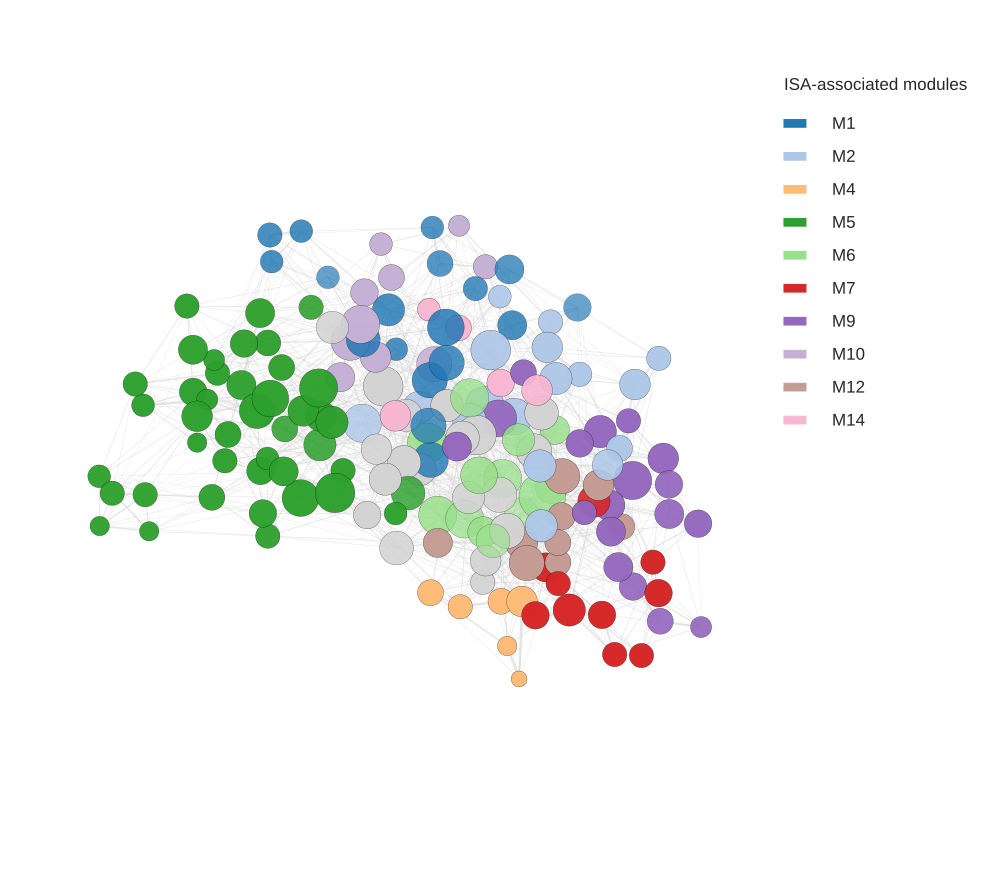](assets/vignette/network_modules_POS_SUB.svg) |

**Which modules carry an indicator association?** Hue identifies the highlighted module in G and H, and degree determines node size. Read colors against the module IDs in each legend. In this mock, both graph summaries report 167 nodes, 1,192 edges and 21 modules. The colored legends highlight ten modules. Use `spieceasi_modules_all.tsv` and `spieceasi_modules_sub.tsv` for assignments across the full set. The report also supplies grayscale degree and abundance views and labeled variants for locating individual ASVs.

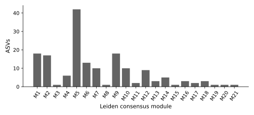

Each bar counts the rows for one module label in `spieceasi_modules_all.tsv`. Compare the sum of the bars (167 nodes) with `n_nodes` in the all-graph row of `spieceasi_module_summary.tsv`. This is the network subset of the 185 retained ASVs.

Select an edge, locate both ASVs in the module table, and inspect their positions in the network plot or open `spieceasi_network_pos_thr.graphml` in a graph viewer. The saved network had 1,192 edges and a largest module of 42 ASVs. Four inferred edges connected members of the same planted module. A shared module indicates a statistical pattern in these simulated abundances. Direct microbial interaction would require separate evidence.

### Compare airway sides and oral case status

[](assets/vignette/site-case-networks.svg)

Start at the top left for the primary airway comparison. Each panel uses the same network edges and layout. Rust identifies an indicator of the first group in the panel legend, charcoal identifies an indicator of the second, and pale gray marks background nodes. Highlighted node area scales with squared indicator strength.

| Panel | Comparison | Patients | Highlighted network ASVs |
| --- | --- | --- | --- |
| Top left | Tumor-side vs healthy airway | 25 cases and 25 controls | 0 |
| Top right | Contralateral vs healthy airway | 25 cases and 25 controls | 0 |
| Bottom left | Tumor-side vs contralateral airway | 25 cases with both sides sampled | Tumor-side: ASV37, ASV63, ASV64. Contralateral: ASV26, ASV30. |
| Bottom right | Oral case vs control | 25 cases and 25 controls | Control: ASV14 |

The paired panel asks where an ASV is preferentially found **within the same patient**. For example, ASV37 favored the tumor side (strength 0.735, q = 0.00135), while ASV30 favored the contralateral side (strength 0.792, q = 0.00135). Neither independent airway comparison yielded a discovery at the selected threshold. Oral ASV14 retained its control association (strength 0.891, q = 0.00544).

The figure command converts final counts to library proportions and keeps the airway sides separate. Each independent contrast uses one library per patient and shuffles labels across patients. The paired contrast includes only complete pairs and randomly swaps the two side labels within each patient. For each ASV observed in a contrast, the test compares the larger of the two single-group indicator strengths against 99,999 random permutations (seed 42). Benjamini–Hochberg adjustment is applied separately across all tested ASVs in each contrast. A node is highlighted when q < 0.05 and strength ≥ 0.25.

In `$WORK/study-figures`, inspect `indicator-contrast-cohorts.tsv` for the sample and patient IDs, and `tumor-side-vs-healthy-indicators.tsv`, `contralateral-vs-healthy-indicators.tsv`, `tumor-side-vs-contralateral-indicators.tsv`, or `oral-case-indicators.tsv` for the ASV-level results. The supplementary figure command produces these tests independently of the pipeline validator.

Finish with the validator’s `indicator_analysis`, `voc_correlation`, `network_analysis` and `manifest_integrity` lines. The saved run passed all 31 checks, including primer accounting and output hashes. The {download}`Cutadapt validation log <../examples/benchmarks/aspire-cami-mock/cutadapt-validation.txt>` records the recovery checks. The earlier fixed-clipping benchmark retained 221 ASVs and has its own {download}`provenance record <../examples/benchmarks/aspire-cami-mock/provenance.json>`. Genome linkage requires separate genome inputs and is outside this amplicon dataset.
