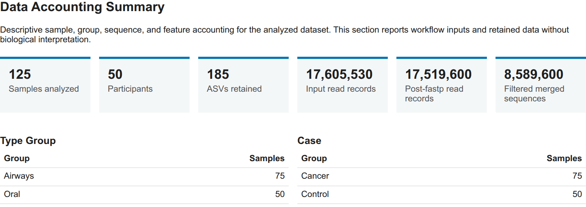
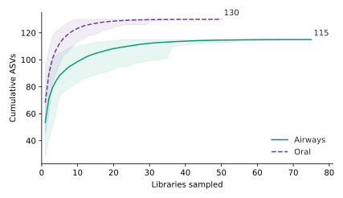
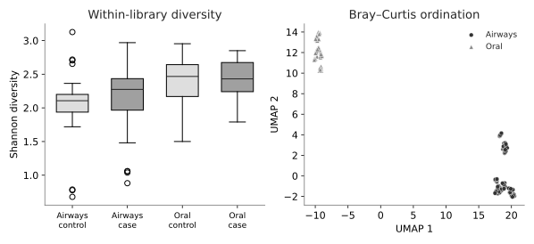

# From airway reads to patient-level associations

Can a respiratory microbiome workflow recover signals planted in a community with repeated sampling, skin controls and extraction blanks? In this vignette you will process paired V4 reads, follow the controls through filtering, and explore which microbial and chemical associations survive patient-level analysis.

```{contents} In this vignette
:local:
:depth: 2
```

## Set up ASPIRE main

Use a 64-bit Linux machine with Git, Python 3 and Mamba on PATH. Budget at least 8 cores, 32 GB RAM and 50 GB of free storage. The first launch requires internet access for environments and taxonomy references. See [installation](installation.md) for prerequisites.

```bash
mkdir -p ~/aspire-vignette
cd ~/aspire-vignette
WORK="$PWD"
git clone --branch main https://github.com/hallamlab/ASPIRE.git
cd ASPIRE
git rev-parse HEAD > "$WORK/aspire-revision.txt"
```

Keep this shell open for the commands below. For an existing checkout, set `WORK` to an absolute analysis directory and run the ASPIRE commands from the repository root.

## Obtain the study

Zenodo deposition is pending. The prepared archive is approximately 2.4 GiB (SHA-256 `a3c87a6ec68113605742cf44de9bc70ea328edd07c05d1dbf321bab56eeef3dc`). If you have the vignette distribution, place `aspire-cami-mock-v1.tar.gz` and its `.sha256` companion in the analysis directory and run:

```bash
(cd "$WORK" && sha256sum -c aspire-cami-mock-v1.tar.gz.sha256 && tar -xzf aspire-cami-mock-v1.tar.gz)
DATASET="$WORK/mock_dataset"
```

You can also generate the study now using the [DECOI CAMI2 body-site instructions](https://hallamlab-decoi.readthedocs.io/en/latest/cami-body-sites.html). Set `DATASET` to the resulting absolute `dataset/mock_dataset` directory. Both routes supply the same input layout.

DECOI simulated 50 patients using CAMI2-derived communities, synthetic chemistry and seed 42. Each of 25 controls contributes one airway, one oral and one skin library. Each of 25 cases contributes two airway libraries (tumor-side and contralateral), one oral and one skin library. Four extraction blanks bring the total to 179. The 50 skin libraries serve as biological controls. Oral and airway libraries form the 125-sample analysis cohort.

```bash
head -n 3 "$DATASET/fastq_manifest.tsv"
head -n 2 "$DATASET/sample_metadata.tsv"
head -n 2 "$DATASET/chemistry.tsv"
```

Follow one sample ID from its R1/R2 paths to its participant, body site and chemistry. Retain the `ground_truth_*.tsv` tables for evaluation after inference. They describe the planted features, group effects, chemical associations and network modules.

## Configure, run and validate

```bash
RESULTS="$WORK/results"
CONFIG="$WORK/cami.yml"
./examples/configure_mock_run.sh --dataset "$DATASET" --output "$RESULTS" --config-out "$CONFIG" --threads 8
./run_asv_pipeline.sh "$CONFIG"
./examples/validate_mock_run.sh --dataset "$DATASET" --results "$RESULTS" > "$WORK/validation.txt"
cat "$WORK/validation.txt"
```

The configurator writes machine-local paths and selects the CAMI clinical profile. Review the generated YAML for primer trimming, biological and technical control definitions, patient column and VOC table. Its current large-study power settings use 1,000 simulations and 999 permutations. To resume, repeat the launcher with the same YAML and retain the results directory and its hidden runtime cache.

Open `summary/report/ASPIRE_run_report.html` inside the results directory. Use the module links to move between figures, source tables and execution logs. For a remote run, see [report viewing](outputs.md#view-reports-on-a-remote-server). The examples below use the saved Cutadapt run, which completed or reused 931 tasks. Numerical values describe that run and can vary with revisions and analysis settings.

### Read the HTML report



Start with **Data Accounting Summary**. The 125 samples tile counts analyzed libraries. The 50 participants tile counts people. Read the Case table horizontally: 75 case libraries came from 25 cases because each case supplied two airway samples and one oral sample to the analysis. The 17,605,530 input read records count both mates of 8,802,765 pairs.


Scroll to **Output Inventory**. In the Diversity card, **Plots** opens the published figures and **Tables** opens the numerical results. File counts include multiple export formats. Use the same pair of links in Taxonomy, Network Analysis and VOC Correlation to explore those results. The screenshots show the saved report; the grayscale study panels below are drawn from its module tables.

## Follow the reads through filtering

The primer audit accounted for all 8,802,765 input pairs. Cutadapt trimmed 8,789,619 pairs with the 515F/806R family and classified 13,146 as unmatched. After fastp, sequence inference and chimera removal, the raw count table contained 498 ASVs. Look at `modules/primer_trimming/tables/primer_cohort.json` for per-library counts.

The 5,000-read biological depth threshold retained all 125 airway and oral libraries. Technical controls flagged 104 ASVs and skin controls flagged 81. Twelve appeared in both lists, so their union removed 173. ASPIRE then screened non-targets and required at least 0.1% relative abundance in one biological sample and nonzero counts in at least 5% of the cohort (seven samples). The final table contained **185 ASVs across 125 libraries**. All four planted non-target features were identified. Inspect the per-feature decisions alongside the count matrix:

```bash
head -n 3 "$RESULTS/modules/non_target_filtering/tables/ASV_target.feature_qc.tsv"
head -n 1 "$RESULTS/modules/non_target_filtering/tables/ASV_target.tsv" | cut -f1-5
```

Read a row in `ASV_target.feature_qc.tsv` before opening a community plot. ASV10 occurred in 56 of 125 eligible libraries (44.8%), reached 18.32% relative abundance in its most abundant library, and passed both filters. Its maximum abundance describes one library; its prevalence describes the cohort.

### How quickly do the two sites accumulate features?



Follow each line from left to right as libraries accumulate. The shading spans the 2.5th to 97.5th percentile in `modules/collectors_curve/tables/{Airways,Oral}_collector_stats.tsv`. At the last point every library from that site is included, so the band closes. Check the endpoint against `collectors_curve_summary.tsv`:

| Site | Libraries | ASVs observed at the endpoint |
| --- | ---: | ---: |
| Airways | 75 | 115 |
| Oral | 50 | 130 |

Compare the curves at the same number of libraries when assessing sampling effort. A feature can occur at both sites, so adding the endpoints would count shared ASVs twice.

## Compare community diversity across patients

Start with Shannon diversity within libraries. Read the case and control distributions within each sample type. Each patient contributes several libraries, so a patient-level comparison needs to account for repeated sampling.



On the left, the center line marks median Shannon diversity and the box spans the middle half of libraries. On the right, each point is a library, circles are airway samples and triangles are oral samples. Nearby points have similar profiles in this embedding. Locate a point by its coordinates in `modules/diversity/tables/umap_coordinates_bray.tsv`, then follow its `Participant_ID` across sites. Use the PERMANOVA table below for the patient-level test. [Original Shannon plot](assets/vignette/alpha_faceted_Shannon_Case.png)

```bash
DIV="$RESULTS/modules/diversity/tables/patient_aware"
cat "$DIV/bray_permanova_case_patient_pooled.tsv"
head "$DIV/bray_permdisp_diagnostics.tsv"
```

The pooled Bray–Curtis PERMANOVA used 25 cases and 25 controls. Case status explained 3.3% of variation (permutation p = 0.128), giving limited evidence for an overall case effect. Examine dispersion diagnostics and the sample-type-specific tables before attributing separation in an ordination to disease group.

### Examine lung side and statistical power

Open `modules/lung_status_analysis/tables/Airways/lung_status_contrasts_summary.tsv` for the airway-specific contrasts. Use `patient_level_metadata.tsv` in the same directory to distinguish paired tumor-side and contralateral observations from independent control patients.

Read across each row before comparing p-values. The paired contrast tests differences within a patient, while each comparison to healthy airways uses different patients.

| Airway contrast | Patients | Libraries | Bray–Curtis R² | Adjusted p | Shannon adjusted p |
| --- | ---: | ---: | ---: | ---: | ---: |
| Tumor-side vs contralateral | 25 | 50 | 0.0145 | 0.003 | 0.914 |
| Contralateral vs healthy | 50 | 50 | 0.0280 | 0.250 | 0.355 |
| Tumor-side vs healthy | 50 | 50 | 0.0268 | 0.250 | 0.355 |

The paired test detects a small community-composition difference despite similar Shannon medians (2.29 and 2.27). Read `permanova_q` for the adjusted composition test and `alpha_q` for the adjusted within-library diversity test.

For a planning question, inspect `modules/power_analysis/tables/power_summary_cancer_vs_control.tsv`. In the saved run, airway PERMANOVA power at the reported grid point of 10 was 0.060, and the 80% target was beyond the tested range. This is a simulation under this mock’s effect sizes and settings. A fresh configuration uses a wider grid and more permutations. Use its own power table to interpret a new run.

## Explore indicator taxa and VOC associations

Look up an ASV in `modules/taxonomy/tables/ASV_SILVA_tax.full-length.vsearch.tsv` to read its assigned lineage and consensus. The saved run assigned taxonomy to 497 of 498 inferred ASVs. To trace the abundances supplied downstream, inspect the before-correction, after-correction and selected CLR tables in `modules/batch_correction/tables/`.


The dots compare the five phyla with the largest airway median in either group. Open `modules/taxonomy/tables/cancer_vs_control/taxonomic_abundance_observed.tsv` and select the Airways, Phylum, Actinobacteriota row. Multiply the median fractions by 100 to recover the plotted positions: 56.94% for cases and 62.81% for controls. The difference is −5.87 percentage points, with adjusted p = 0.793. The spacing of those two symbols describes the observed effect; the table supplies its statistical test.

Open `modules/indicator_analysis/tables/Case_indicator_species_results.tsv` and inspect the group columns, indicator statistic and permutation p-value. The validator maps inferred features to simulated sequences and found 22 of the 48 planted indicator ASVs across the evaluated indicator analyses. ASV numbers are assigned within each run.

For an indicator example, find ASV14 in `Case_indicator_species_summary.tsv` in the same directory. The selected Control group has `s.Control = 1`, the indicator statistic is 0.859, and the adjusted p-value is 0.002. Use sequence identity to compare this indicator with the planted truth in a different run.


Read down the acetone column. ASV295 and ASV173 have positive coefficients, while ASV66 has a negative coefficient. Read across any row to compare compounds for the same ASV. Blue shows negative and rust shows positive associations on a common −1 to +1 scale. Cell labels give rho; adjusted p-values appear in the permutation table. These three rows illustrate the patient-level relative-abundance analysis. [Full sample-level clustermap from the report](assets/vignette/asv_voc_clustermap.svg)

Use the heatmap to select a candidate, then check the patient-level estimate, sample support, normalization and multiple-testing adjustment. This command lists the five tested relative-abundance associations with the lowest adjusted p-values:

```bash
python3 - "$RESULTS/modules/voc_correlation/tables/patient_asv_voc_permutation_long.tsv" <<'PY'
import csv
import sys
with open(sys.argv[1]) as source:
    rows = [r for r in csv.DictReader(source, delimiter="\t")
            if r["normalization"] == "relative_abundance" and r["status"] == "tested"]
for row in sorted(rows, key=lambda r: float(r["q_value"]))[:5]:
    print(*(row[k] for k in ("asv_label", "voc", "n_patients", "rho", "q_value")), sep="\t")
PY
```

For example, ASV295 (assigned to *Massilia*) and acetone had a positive patient-level association (50 patients, Spearman rho = 0.669, adjusted p = 0.0104). This measures covariation in synthetic patients. Across the separate sample-level truth check, six of 17 planted positive ASV–VOC pairs reached the validator’s Spearman rho threshold of 0.30. See [VOC statistics](VOC_STATISTICS.md) for normalization and permutation details.

## Explore network structure and assess recovery

```bash
NET="$RESULTS/modules/network_analysis/tables"
head "$NET/spieceasi_edge_list.csv"
head "$NET/spieceasi_modules_all.tsv"
cat "$NET/network_topology_summary.tsv"
```


Start with the published degree plot to locate highly connected nodes. Use `spieceasi_node_features.csv` for an exact value: ASV10 has 13 neighbors in the thresholded graph. In the edge list, ASV10 connects to ASV125 with weight 0.0341. Looking both up in `spieceasi_modules_all.tsv` places ASV10 in M1 and ASV125 in M9. An edge can cross a module boundary.


Each bar counts the rows for one module label in `spieceasi_modules_all.tsv`. Compare the sum of the bars (167 nodes) with `n_nodes` in the all-graph row of `spieceasi_module_summary.tsv`. This is the network subset of the 185 retained ASVs.

Select an edge, locate both ASVs in the module table, and inspect their positions in the network plot or open `spieceasi_network_pos_thr.graphml` in a graph viewer. The saved network had 1,192 edges and a largest module of 42 ASVs. Four inferred edges connected members of the same planted module. A shared module indicates a statistical pattern in these simulated abundances. Direct microbial interaction would require separate evidence.

Finish with the validator’s `indicator_analysis`, `voc_correlation`, `network_analysis` and `manifest_integrity` lines. The saved run passed all 31 checks, including primer accounting and output hashes. The {download}`Cutadapt validation log <../examples/benchmarks/aspire-cami-mock/cutadapt-validation.txt>` records the recovery checks. The earlier fixed-clipping benchmark retained 221 ASVs and has its own {download}`provenance record <../examples/benchmarks/aspire-cami-mock/provenance.json>`. Genome linkage requires separate genome inputs and is outside this amplicon dataset.
