# From airway reads to patient-level associations

Can a respiratory microbiome workflow recover signals planted in a community with repeated sampling, skin controls and extraction blanks? In this vignette you will process paired V4 reads, follow the controls through filtering, and explore which microbial and chemical associations survive patient-level analysis. The final worked example follows an airway indicator ASV from its site assignment to its association with acetone across 50 synthetic patients.

```{contents} In this vignette
:local:
:depth: 2
```

## Set up ASPIRE main

Use a 64-bit Linux machine with Git, Python 3 and Mamba on PATH. Budget at least 8 cores, 32 GB RAM and 50 GB of free storage. The first launch requires internet access for environments and taxonomy references. See [installation](installation.md) for prerequisites. Click the two-square icon in the top-right corner of a command block, paste into your terminal, and press Enter. For a first run, create a workspace and download ASPIRE.

```bash
mkdir -p ~/aspire-vignette
cd ~/aspire-vignette
git clone --branch main https://github.com/hallamlab/ASPIRE.git
```

If you already cloned ASPIRE here, update your checkout instead.

```bash
cd ~/aspire-vignette/ASPIRE
git pull --ff-only origin main
```

Record the revision used for your run.

```bash
cd ~/aspire-vignette/ASPIRE
git rev-parse HEAD > ../aspire-revision.txt
```

## Obtain the study

Zenodo deposition is pending. The prepared archive is approximately 2.4 GiB (SHA-256 `a3c87a6ec68113605742cf44de9bc70ea328edd07c05d1dbf321bab56eeef3dc`). Download or copy both `aspire-cami-mock-v1.tar.gz` and `aspire-cami-mock-v1.tar.gz.sha256` to `~/aspire-vignette`. Check the downloaded files before extracting them.

```bash
cd ~/aspire-vignette
sha256sum -c aspire-cami-mock-v1.tar.gz.sha256
```

When the checksum prints **OK**, extract the study.

```bash
cd ~/aspire-vignette
tar -xzf aspire-cami-mock-v1.tar.gz
```

You can also generate the study now using the [DECOI CAMI2 body-site instructions](https://hallamlab-decoi.readthedocs.io/en/latest/cami-body-sites.html). For that route, skip the checksum and extraction steps and copy the resulting `mock_dataset` directory into `~/aspire-vignette/` before continuing. Both routes use `~/aspire-vignette/mock_dataset/fastq_manifest.tsv`.

DECOI simulated 50 patients using CAMI2-derived communities, synthetic chemistry and seed 42. Each of 25 controls contributes one airway, one oral and one skin library. Each of 25 cases contributes two airway libraries (tumor-side and contralateral), one oral and one skin library. Four extraction blanks bring the total to 179. The 50 skin libraries serve as biological controls. Oral and airway libraries form the 125-sample analysis cohort.

```bash
cd ~/aspire-vignette/mock_dataset
head -n 3 fastq_manifest.tsv
head -n 2 sample_metadata.tsv
head -n 2 chemistry.tsv
```

Follow one sample ID from its R1/R2 paths to its participant, body site and chemistry. Retain the `ground_truth_*.tsv` tables for evaluation after inference. They describe the planted features, group effects, chemical associations and network modules.

## Configure, run and validate

Create the configuration file.

```bash
cd ~/aspire-vignette/ASPIRE
./examples/configure_mock_run.sh --dataset ../mock_dataset --output ../results --config-out ../cami.yml --threads 8
```

Run ASPIRE. Wait for the pipeline to finish.

```bash
cd ~/aspire-vignette/ASPIRE
./run_asv_pipeline.sh ../cami.yml
```

Validate the results. Look for **All mock-run checks passed.**

```bash
cd ~/aspire-vignette/ASPIRE
./examples/validate_mock_run.sh --dataset ../mock_dataset --results ../results
```

The configurator writes machine-local paths and selects the CAMI clinical profile. Review the generated YAML for primer trimming, biological and technical control definitions, patient column and VOC table. Its current large-study power settings use 1,000 simulations and 999 permutations. To resume, repeat the launcher with the same YAML and retain the results directory and its hidden runtime cache.

Open `~/aspire-vignette/results/summary/report/ASPIRE_run_report.html`. Use the module links to move between figures, source tables and execution logs. For a remote run, see [report viewing](outputs.md#view-reports-on-a-remote-server). The report screenshots below come from the completed run in `aspire-vignette.tar.gz`. Its `aspire-revision.txt` records revision `b2ee099`.

### Read the HTML report


Start with **Data Accounting Summary**. The 125 samples tile counts analyzed libraries. The 50 participants tile counts people. Read the Case table horizontally: 75 case libraries came from 25 cases because each case supplied two airway samples and one oral sample to the analysis. The 17,605,530 input read records count both mates of 8,802,765 pairs.

The first figure in the report is the all-library Data-loss Sankey, shown at full size in the read-flow walkthrough below. The next row shows read depth by site, ASV overlap and the collector’s curve. Read the swarmplot vertically for depth differences among libraries. Use the UpSet bars for shared and site-specific features, then follow the collector’s curves to see how quickly each site reaches its observed richness.

[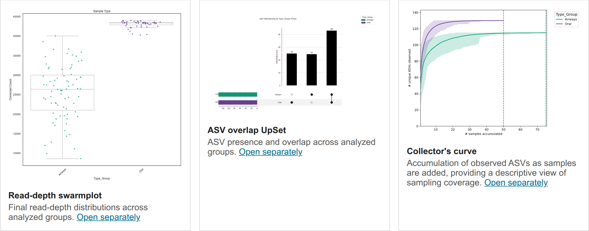](assets/vignette/report-plots.png)

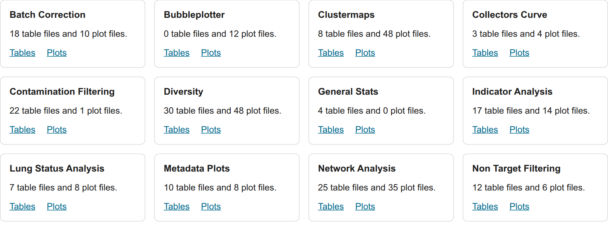

Scroll to **Output Inventory**. In the Diversity card, **Plots** opens the published figures and **Tables** opens the numerical results. File counts include multiple export formats. Use the same pair of links in Taxonomy, Network Analysis and VOC Correlation to explore those results. The inventory lists the files ASPIRE published under `results/modules/`. The commands below create additional study figures in `study-figures/`.

## Make the study figures from your run

The native module plots below come from the archived run. Figure descriptions appear in the walkthrough, and the standalone SVGs use consistent label sizes. The additional study panels, including the gallery scripts’ restyled network and ISA copies, and the worked numerical examples were prepared from an earlier CAMI Cutadapt benchmark. For example, the archived sample-level VOC heatmap labels ASV157 as *Delftia*, whereas the earlier benchmark assigned that number to *Treponema*. Use the tables from your own run when following an individual ASV.

After validation, create the plotting environment once. When Mamba asks whether to proceed, enter `y`.

```bash
mamba create -n aspire-vignette-figures -c conda-forge python=3.11 matplotlib pandas numpy 'scipy>=1.11' networkx
```

Generate the figures from your results. The first command after `cd` creates the read-flow, taxonomy, indicator and network panels. The second creates the collector, diversity, module-size and patient–VOC figures. Open the SVGs and their companion tables in `~/aspire-vignette/study-figures`.

```bash
cd ~/aspire-vignette/ASPIRE/examples/benchmarks/aspire-cami-mock
mamba run -n aspire-vignette-figures python render_study_figures.py ~/aspire-vignette/results ~/aspire-vignette/study-figures
mamba run -n aspire-vignette-figures python render_vignette.py ~/aspire-vignette/results ~/aspire-vignette/study-figures
```

SPARK used oral rinse, BAL and bronchial brush samples, and documented separate pre- and post-host-exclusion stages. This walkthrough follows the mock’s airway/oral design. In particular, the read-flow panel spans processing stages, the overlap and site-specific case tests use final features, and the network shows only its modeled subset.

## Follow the reads through filtering

The primer audit accounted for all 8,802,765 input pairs. Cutadapt trimmed 8,789,619 pairs with the 515F/806R family and classified 13,146 as unmatched. After fastp, sequence inference and chimera removal, the raw count table contained 498 ASVs. Look at `modules/primer_trimming/tables/primer_cohort.json` for per-library counts.

The 5,000-read biological depth threshold retained all 125 airway and oral libraries. Technical controls flagged 104 ASVs and skin controls flagged 81. Twelve appeared in both lists, so their union removed 173. ASPIRE then screened non-targets and required at least 0.1% relative abundance in one biological sample and nonzero counts in at least 5% of the cohort (seven samples). The final table contained **185 ASVs across 125 libraries**. All four planted non-target features were identified. Inspect the per-feature decisions alongside the count matrix:

```bash
cd ~/aspire-vignette/results/modules/non_target_filtering/tables
head -n 3 ASV_target.feature_qc.tsv
```

Read a row in `ASV_target.feature_qc.tsv` before opening a community plot. ASV10 occurred in 56 of 125 eligible libraries (44.8%), reached 18.32% relative abundance in its most abundant library, and passed both filters. Its maximum abundance describes one library; its prevalence describes the cohort.

[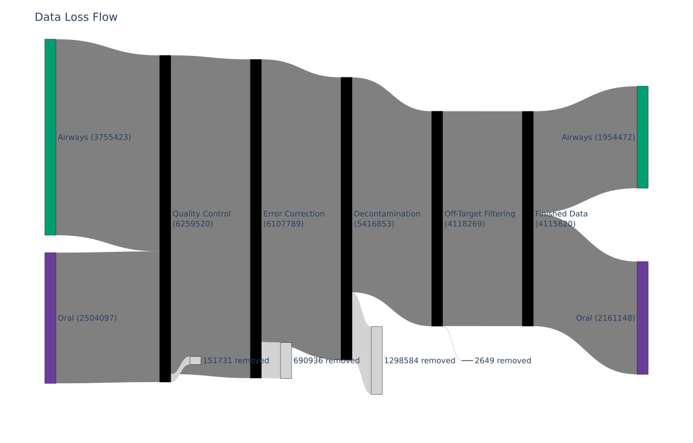](assets/vignette/mock-read-flow.svg)

Start at **Input pairs**. Ribbon widths represent counts in read pairs or merged-read equivalents. The four groups contribute 8,802,765 pairs in total, including 2,504,212 from skin and 39,033 from extraction blanks. Follow the ribbons to **Eligible biological cohort**, where only airway and oral libraries continue. The rightmost biological total is 4,074,475. For interactive values, open `results/modules/sankey/plots/data_loss_sankey_raw.label.html`, the file embedded in the archived report. Next, inspect the [read-depth plot by control class](assets/vignette/read_depth_by_class.svg). It helps explain why the four extraction blanks can contribute control evidence even though biological libraries must pass a depth threshold.

**Exclusive intersections**

[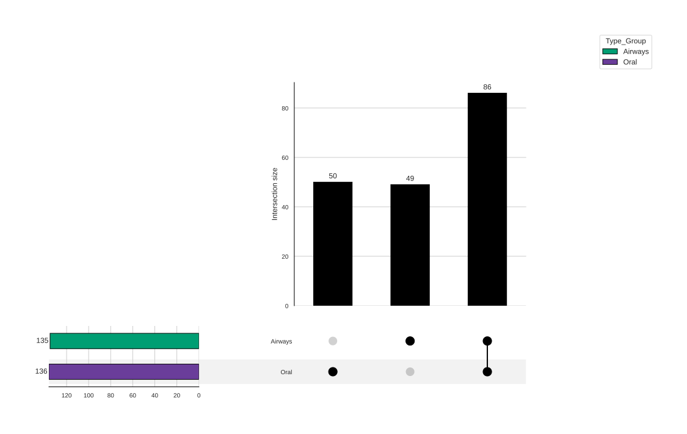](assets/vignette/final_micro_upset.svg)

**Presence by site**

[](assets/vignette/site-overlap.svg)


In the UpSet plot, read the filled site dots under a bar to identify its intersection, then read the bar height for the count. The overlap diagram shows the same counts as regions: 49 occurred only in airway libraries, 86 occurred at both sites, and 50 occurred only in oral libraries. Their sum gives the 185 final ASVs. Circle areas are schematic. Follow an individual ASV in `modules/upset/tables/final_micro_final_venn_presence_table.tsv`.

### How quickly do the two sites accumulate features?


Follow each line from left to right as libraries accumulate. The shading spans the 2.5th to 97.5th percentile in `modules/collectors_curve/tables/{Airways,Oral}_collector_stats.tsv`. At the last point every library from that site is included, so the band closes. Check the endpoint against `collectors_curve_summary.tsv`:

| Site | Libraries | ASVs observed at the endpoint |
| --- | ---: | ---: |
| Airways | 75 | 115 |
| Oral | 50 | 130 |

Compare the curves at the same number of libraries when assessing sampling effort. A feature can occur at both sites, so adding the endpoints would count shared ASVs twice.

## Compare community diversity across patients

Start with Shannon diversity within libraries. Read the case and control distributions within each sample type. Each patient contributes several libraries, so a patient-level comparison needs to account for repeated sampling.


Green represents airways and purple represents oral libraries in both panels. On the left, hatched boxes identify cases. The center line marks median Shannon diversity and the box spans the middle half of libraries. On the right, each point is a library, circles are airway samples and triangles are oral samples. Nearby points have similar profiles in this embedding. Locate a point by its coordinates in `modules/diversity/tables/umap_coordinates_bray.tsv`, then follow its `Participant_ID` across sites. Use the PERMANOVA table below for the patient-level test. In the archived Shannon figure, airways are on the left and oral libraries are on the right. [Shannon plot](assets/vignette/alpha_faceted_Shannon_Case.svg)

```bash
cd ~/aspire-vignette/results/modules/diversity/tables/patient_aware
cat bray_permanova_case_patient_pooled.tsv
head bray_permdisp_diagnostics.tsv
```

The pooled Bray–Curtis PERMANOVA used 25 cases and 25 controls. Case status explained 3.3% of variation (permutation p = 0.128), giving limited evidence for an overall case effect. Examine dispersion diagnostics and the sample-type-specific tables before attributing separation in an ordination to disease group.

Open the [within-patient Bray–Curtis distance plot](assets/vignette/Bray_Boxplot_sample_type_within_patient.svg) alongside the ordination. Read a higher Bray–Curtis distance as greater compositional dissimilarity between two samples from the same patient. The ordination displays each library separately.

### Examine lung side and statistical power

Open `modules/lung_status_analysis/tables/Airways/lung_status_contrasts_summary.tsv` for the airway-specific contrasts. Use `patient_level_metadata.tsv` in the same directory to distinguish paired tumor-side and contralateral observations from independent control patients.

Read across each row before comparing p-values. The paired contrast tests differences within a patient, while each comparison to healthy airways uses different patients.

| Airway contrast | Patients | Libraries | Bray–Curtis R² | Adjusted p | Shannon adjusted p |
| --- | ---: | ---: | ---: | ---: | ---: |
| Tumor-side vs contralateral | 25 | 50 | 0.0145 | 0.003 | 0.914 |
| Contralateral vs healthy | 50 | 50 | 0.0280 | 0.250 | 0.355 |
| Tumor-side vs healthy | 50 | 50 | 0.0268 | 0.250 | 0.355 |

The paired test detects a small community-composition difference despite similar Shannon medians (2.29 and 2.27). Read `permanova_q` for the adjusted composition test and `alpha_q` for the adjusted within-library diversity test.

How much power does this mock have at its actual size? The archived power curve below extends to 25 cancer patients per site. The run excludes contralateral airway libraries from the case–control comparison. Its separate paired-site grid extends to 50 participants.

A separate focused rerun on the earlier benchmark count table used 25 cases and 25 controls per site, 1,000 patient bootstrap simulations, 999 permutations per PERMANOVA test, seed 42 and α = 0.05. “Observed” resamples patients within their original groups. The null scenario pools patients before assigning group labels. Values below are the fraction of simulations rejecting the null.

| Site | Bray–Curtis, observed | Bray–Curtis, null | Shannon, observed | Shannon, null |
| --- | ---: | ---: | ---: | ---: |
| Airways | 37.7% | 5.5% | 26.7% | 4.7% |
| Oral | 37.8% | 5.5% | 6.9% | 4.7% |

Even at the actual cohort size, the overall disease contrasts fall short of 80% under these assumptions. Compare that result with the paired airway-side test above, then follow the site indicators into the final patient-level chemistry analysis. Each asks a different biological question.

**Lung-side contrasts**

[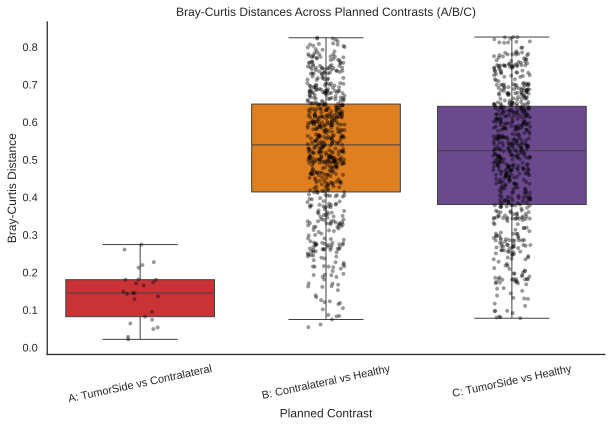](assets/vignette/Distance_contrasts_ABC.svg)

**Power by sample size**

[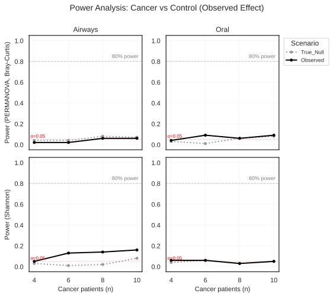](assets/vignette/power_curves_cancer_vs_control_simple.svg)


Use the contrast table above to recover the patient denominator for each distance comparison. On the power plot, follow Observed and True_Null to 25 cancer patients on the horizontal axis. Read the upper panels for Bray–Curtis and the lower panels for Shannon. Airways are on the left and oral libraries are on the right. The red dotted line marks α = 0.05 and the dashed gray line marks 80% power.

## Trace taxonomic abundance across patients

### What clusters together at phylum and family level?

[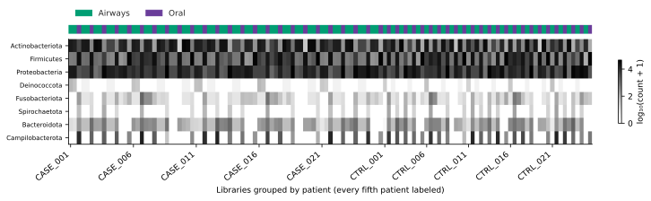](assets/vignette/phylum-patient-heatmap.svg)

Start with the eight phyla. Each column is one library. Deeper purple means a higher log₁₀(count + 1) for that taxon and library. The top dendrogram groups libraries with similar taxon profiles. The left dendrogram groups taxa with similar profiles across libraries. Both use Ward hierarchical clustering with Euclidean distance on the displayed log counts. Library depth can influence this view.

Read the site strip **after** inspecting the top tree. In the saved run, the 75 green airway libraries and 50 purple oral libraries form contiguous blocks even though the clustering uses no site labels. The first two phylum columns are a healthy airway and a contralateral airway from different patients. Their proximity describes similar abundance profiles across phyla.

[](assets/vignette/family-patient-heatmap.svg)

Repeat at family level to resolve patterns hidden inside a phylum. The 38 rows include the pooled *Other* category. For example, the first two columns at this rank are tumor-side libraries from two different patients, both with high Corynebacteriaceae counts. Each rank has its own column order. To identify a cell, open `family-patient-heatmap.tsv` or `phylum-patient-heatmap.tsv` and match its column name to the sample ID in the corresponding `family-heatmap-column-order.tsv` or `phylum-heatmap-column-order.tsv`.

### How much do the taxa contribute at each site?

[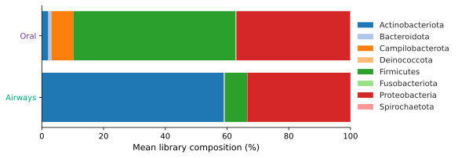](assets/vignette/phylum-composition.svg)

Read each stacked bar from left to right. Segment width gives the mean percentage assigned to each phylum, with equal weight per library. Match the segment hue to the phylum legend. Actinobacteriota accounts for 58.9% of mean airway composition and 2.1% of mean oral composition. Each complete bar sums to 100%.

[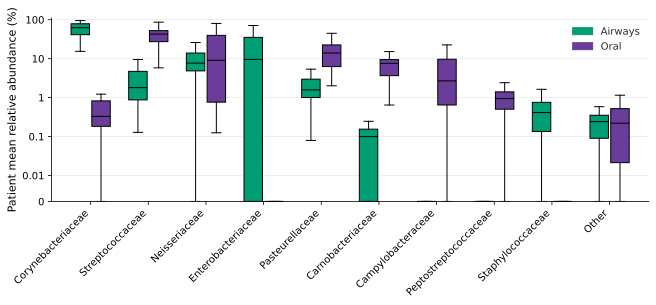](assets/vignette/family-abundance.svg)

Read the green airway and purple oral boxes side by side. Each observation is one patient's mean library proportion at that site. The center line is the median and the box spans the middle half of patients. Above 0.01%, each tick is a tenfold increase. The short linear interval from 0 to 0.01% preserves true zeros. For Corynebacteriaceae the medians are 62.2% in airways and 0.33% orally. Streptococcaceae shows the opposite pattern (1.80% and 42.7%). The ten categories were selected by overall mean library proportion. Open `family-abundance.tsv` for every patient value, including values beyond the whiskers.

## Identify indicator taxa

Look up an ASV in `modules/taxonomy/tables/ASV_SILVA_tax.full-length.vsearch.tsv` to read its assigned lineage and consensus. The saved run assigned taxonomy to 497 of 498 inferred ASVs. To trace the abundances supplied downstream, inspect the before-correction, after-correction and selected CLR tables in `modules/batch_correction/tables/`.

Open `modules/indicator_analysis/tables/Case_indicator_species_results.tsv` and inspect the group columns, indicator statistic and permutation p-value. The validator maps inferred features to simulated sequences and found 22 of the 48 planted indicator ASVs across the evaluated indicator analyses. ASV numbers are assigned within each run.

For an indicator example, find ASV14 in `Case_indicator_species_summary.tsv` in the same directory. The selected Control group has `s.Control = 1`, the indicator statistic is 0.859, and the adjusted p-value is 0.002. Use sequence identity to compare this indicator with the planted truth in a different run.

### Read the indicator species analysis (ISA) plots

**A · Sample-type indicators**

[](assets/vignette/type_group_ISA_plot.svg)

**B · Case vs control, single-group fit**

[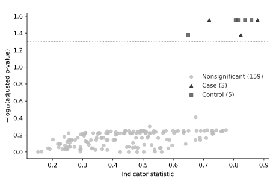](assets/vignette/case-isa-single-group.svg)


Read rightward for a stronger indicator statistic and upward for a smaller adjusted p-value. A height of 2 corresponds to q = 0.01. In A, the combination-allowed sample-type fit called 119 indicators. In B, the **single-group** case-versus-control fit accounts for all 185 retained ASVs. It plots all 167 with a finite statistic and q-value: 159 nonsignificant circles and eight significant case or control indicators (q < 0.05). The other 18 lack coordinates and are counted above the axes. The dotted line marks q = 0.05. Points at identical coordinates can overlap. Use `case-isa-single-group.tsv` in the study-figures directory to inspect every row.

**Why did the original case plot look nearly empty?** The [original combination-allowed case view](assets/vignette/case_ISA_plot.svg) answers a different question. ASPIRE omits the full Cancer + Control union from its summary: 161 of 185 ASVs fell out at this step. Of the remaining 24, 18 lacked a statistic and q-value, leaving six plottable points, three significant. The single-group fit compares Cancer and Control directly and has its own adjusted p-values. Panels C and D below retain the combination-allowed fit so you can inspect that result too.

**C · Case statistic by sample type**

[](assets/vignette/Combined_ISA_plot.svg)

**D · Case statistic by phylum**

[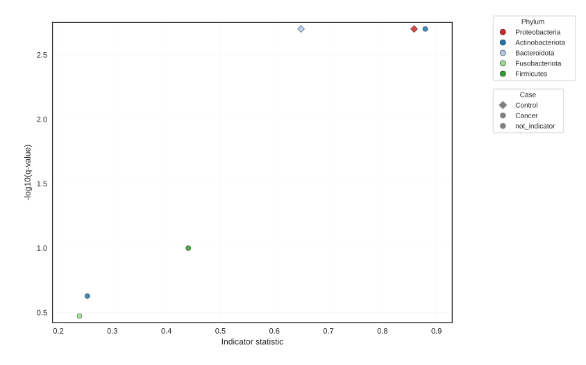](assets/vignette/Combined_ISA_plot_Phylum.svg)


C and D use the **case-status** statistic and adjusted p-value for both axes. Marker shape identifies the case-status assignment. Green and purple in C identify airway and oral assignments. The hues in D identify phyla; gray marks unassigned indicator status in the legend. Use the legend for each panel. For a phylum view on the **sample-type** axes, open the [sample-type ISA plot by phylum](assets/vignette/type_group_ISA_plot_Phylum.svg).

Trace ASV10 through `modules/indicator_analysis/tables/Type_Group__Case/Combined_ISA_with_taxonomy.tsv`. Its sample-type statistic is 0.999, q = 0.00127, and its label is Oral (purple in A). Its phylum is Firmicutes. Its case-statistic fields are empty, so its strong oral association does not yield a point on the case-statistic axes.

### Compare the same indicators by site and phylum

**Sample-type assignment**

[](assets/vignette/type_group_ISA_plot.svg)

**Phylum assignment**

[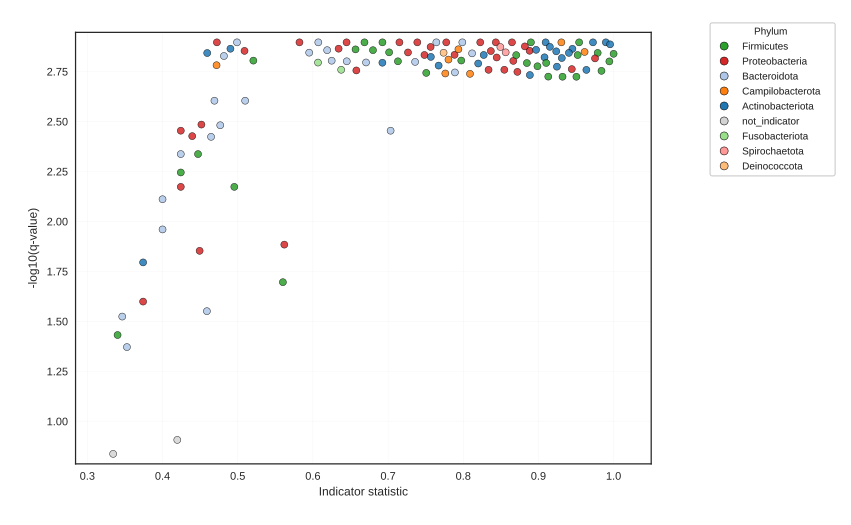](assets/vignette/type_group_ISA_plot_Phylum.svg)


This pair keeps the sample-type axes fixed. ASV10 is the oral-associated Firmicutes example in both views. Use `type_group_ISA_with_taxonomy.tsv` for its exact position and taxonomic assignment.

[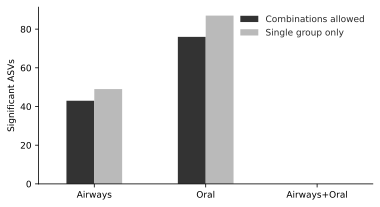](assets/vignette/indicator-partitions.svg)

Allowing group combinations yielded 43 airway and 76 oral indicators. Restricting the model to single groups yielded 49 and 87. Neither fit reported a significant Airways + Oral assignment. Green bars count airway assignments, purple bars count oral assignments, and the joint category is gray. Each bar counts significant entries in the corresponding Type_Group summary; overlapping model results should not be added together.

## Explore network structure and assess recovery

```bash
cd ~/aspire-vignette/results/modules/network_analysis/tables
head spieceasi_edge_list.csv
head spieceasi_modules_all.tsv
cat network_topology_summary.tsv
```

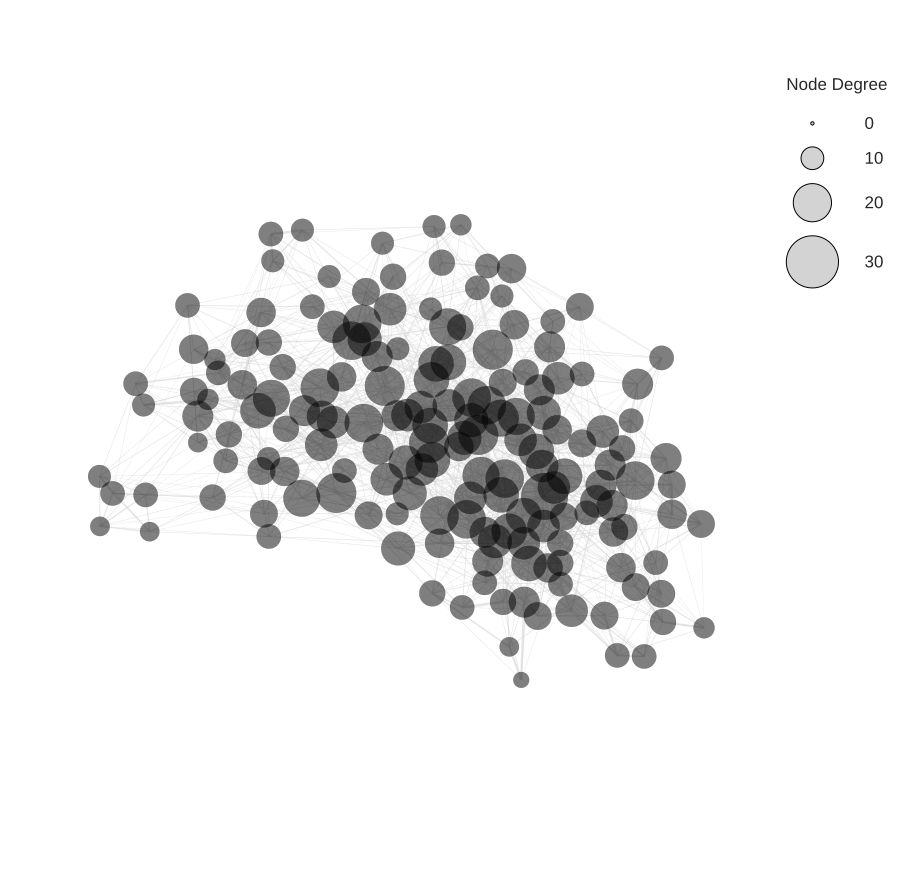

Each node is an ASV. Read the **Node Degree** legend on the right from top to bottom. Each circle shows the size for the value beside it. Larger nodes have more neighbors, and thicker edges have larger absolute weights. Use the degree plot to locate highly connected ASVs. Use `spieceasi_node_features.csv` for an exact value: ASV10 has 13 neighbors in the thresholded graph. In the edge list, ASV10 connects to ASV125 with weight 0.0341. Looking both up in `spieceasi_modules_all.tsv` places ASV10 in M1 and ASV125 in M9. An edge can cross a module boundary.

### Interpret the network color panels

**A · Sample-type ISA**

[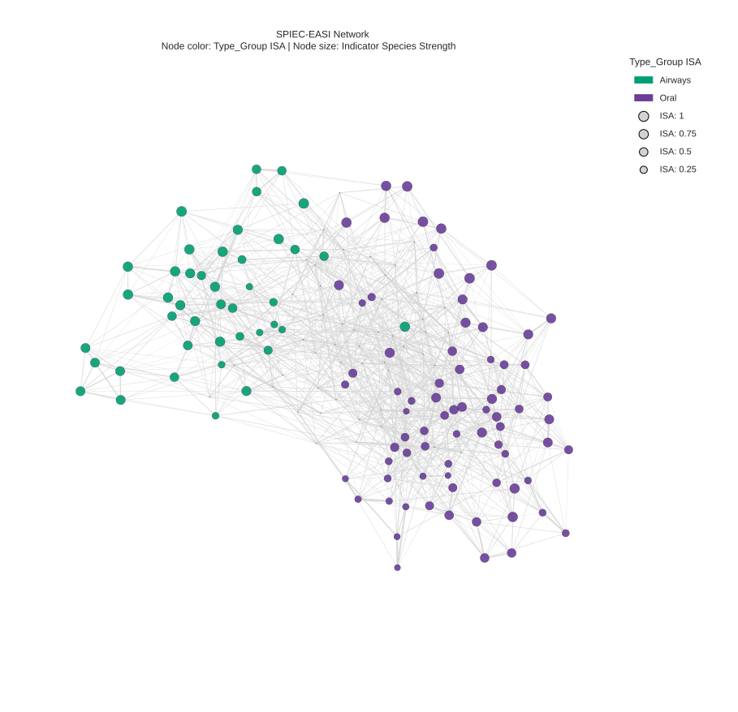](assets/vignette/network_Type_Group_ISA.svg)

**B · Case-status ISA**

[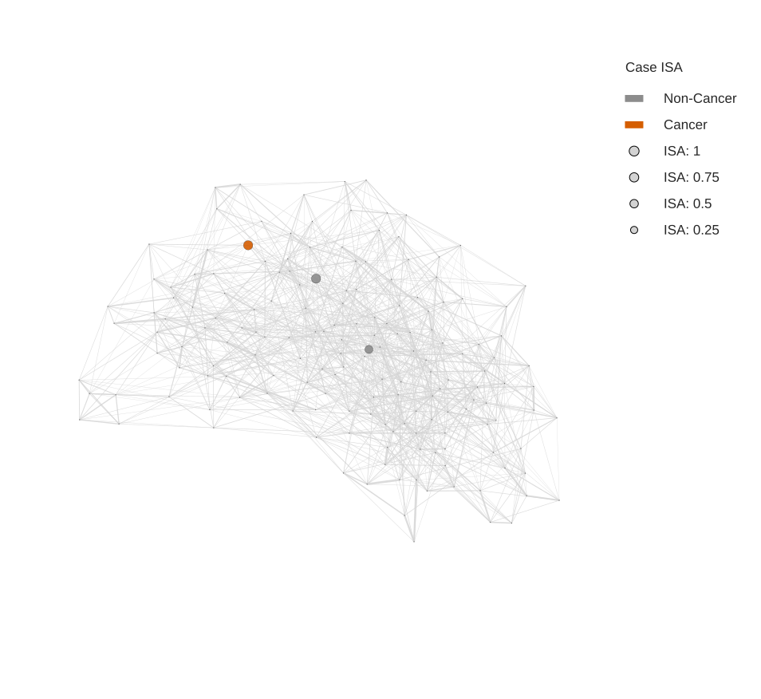](assets/vignette/network_Case_ISA.svg)


**Which groups do connected ASVs indicate?** A uses green for airway indicators and purple for oral indicators. In B, orange marks Cancer indicators, medium gray marks Non-Cancer indicators and pale gray marks background nodes. Node size encodes indicator strength. Follow ASV10 from the oral indicator table into A; use the labeled SVG in the run’s plots directory to locate it. For gray nodes in B, consult the case summary to distinguish an assigned control indicator from a background node.

**C · Phylum and indicator strength**

[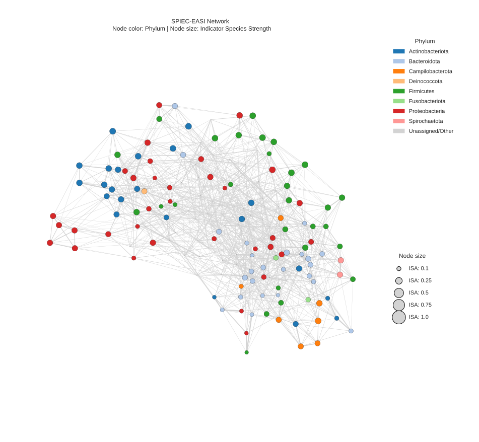](assets/vignette/network_phylum_ISA.svg)

**D · Phylum and mean abundance**

[](assets/vignette/network_phylum_ABUND_MEAN.svg)


**Is a strong indicator also abundant?** C and D use the same phylum colors. For example, green identifies Firmicutes and blue identifies Actinobacteriota. Size changes from indicator strength to log-scaled mean abundance. Compare relative prominence within each panel using its size legend. The default `network_phylum_ABUND.svg` also shows the mean-abundance view.

**E · Phylum and median abundance**

[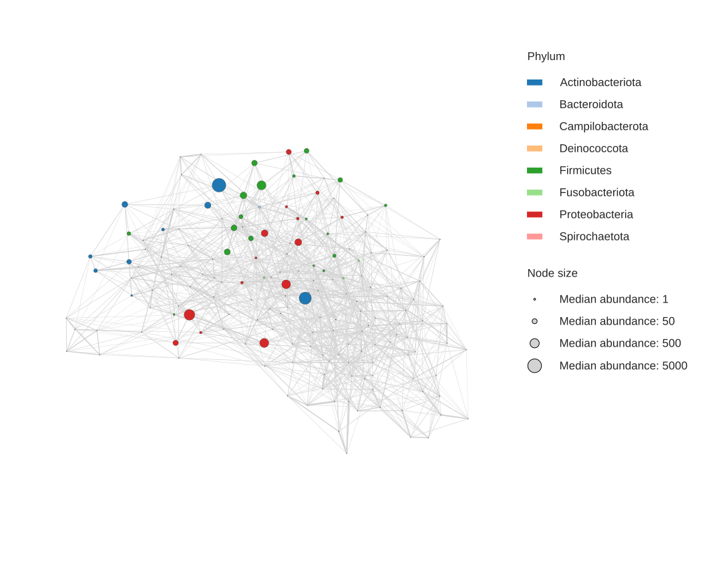](assets/vignette/network_phylum_ABUND_MEDIAN.svg)

**F · Betweenness class and degree**

[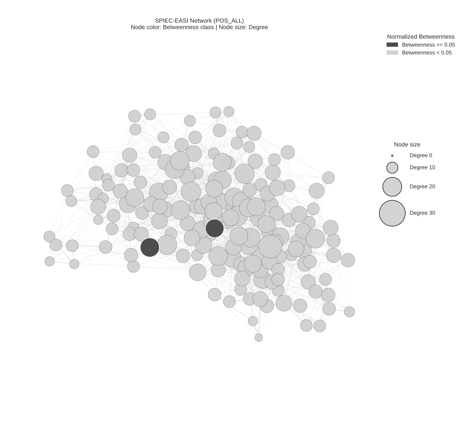](assets/vignette/network_betweenness_POS_ALL.svg)


**How typical or structurally central is the ASV?** Compare E with D: a node prominent by mean but small by median warrants inspecting the distribution of its counts across libraries. In F, shading marks normalized betweenness at or above versus below 0.05; size gives degree. In `spieceasi_node_features.csv`, ASV10 has degree 13 and normalized betweenness 0.0435, placing it below that threshold.

**G · ISA-associated modules, POS_ALL**

[](assets/vignette/network_modules_POS_ALL.svg)

**H · ISA-associated modules, POS_SUB**

[](assets/vignette/network_modules_POS_SUB.svg)


**Which modules carry an indicator association?** In G and H, match each node color to a module ID in that panel’s legend. Pale gray marks the background and degree determines node size. Use the module IDs in the assignment tables for exact membership. In this mock, both graph summaries report 167 nodes, 1,192 edges and 21 modules. Each archived legend lists ten highlighted modules. For example, M8 appears in the POS_ALL legend and M6 appears in POS_SUB. Look up membership in `spieceasi_modules_all.tsv` for G and `spieceasi_modules_sub.tsv` for H. The report also supplies grayscale degree and abundance views and labeled variants for locating individual ASVs.


Each bar counts the rows for one module label in `spieceasi_modules_all.tsv`. Compare the sum of the bars (167 nodes) with `n_nodes` in the all-graph row of `spieceasi_module_summary.tsv`. This is the network subset of the 185 retained ASVs.

Select an edge, locate both ASVs in the module table, and inspect their positions in the network plot or open `spieceasi_network_pos_thr.graphml` in a graph viewer. The saved network had 1,192 edges and a largest module of 42 ASVs. Four inferred edges connected members of the same planted module. A shared module indicates a statistical pattern in these simulated abundances. Direct microbial interaction would require separate evidence.

### Compare airway sides and oral case status

[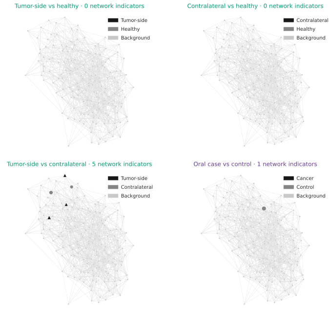](assets/vignette/site-case-networks.svg)

The top row compares tumor-side airways (left) and contralateral airways (right) with healthy airways. The bottom row compares the two airway sides within cases (left) and oral cases with controls (right). Each panel uses the same network edges and layout. Dark triangles identify indicators of the first group, medium-gray circles identify indicators of the second, and small pale-gray circles mark background nodes. Highlighted node area scales with squared indicator strength.

| Panel | Comparison | Patients | Highlighted network ASVs |
| --- | --- | --- | --- |
| Top left | Tumor-side vs healthy airway | 25 cases and 25 controls | 0 |
| Top right | Contralateral vs healthy airway | 25 cases and 25 controls | 0 |
| Bottom left | Tumor-side vs contralateral airway | 25 cases with both sides sampled | Tumor-side: ASV37, ASV63, ASV64. Contralateral: ASV26, ASV30. |
| Bottom right | Oral case vs control | 25 cases and 25 controls | Control: ASV14 |

The paired panel asks where an ASV is preferentially found **within the same patient**. For example, ASV37 favored the tumor side (strength 0.735, q = 0.00135), while ASV30 favored the contralateral side (strength 0.792, q = 0.00135). Neither independent airway comparison yielded a discovery at the selected threshold. Oral ASV14 retained its control association (strength 0.891, q = 0.00544).

The figure command converts final counts to library proportions and keeps the airway sides separate. Each independent contrast uses one library per patient and shuffles labels across patients. The paired contrast includes only complete pairs and randomly swaps the two side labels within each patient. For each ASV observed in a contrast, the test compares the larger of the two single-group indicator strengths against 99,999 random permutations (seed 42). Benjamini–Hochberg adjustment is applied separately across all tested ASVs in each contrast. A node is highlighted when q < 0.05 and strength ≥ 0.25.

In `~/aspire-vignette/study-figures`, inspect `indicator-contrast-cohorts.tsv` for the sample and patient IDs, and `tumor-side-vs-healthy-indicators.tsv`, `contralateral-vs-healthy-indicators.tsv`, `tumor-side-vs-contralateral-indicators.tsv`, or `oral-case-indicators.tsv` for the ASV-level results. The supplementary figure command produces these tests independently of the pipeline validator.

Cross-check the validator’s `indicator_analysis`, `voc_correlation`, `network_analysis` and `manifest_integrity` lines. The saved run passed all 31 checks, including primer accounting and output hashes. The {download}`Cutadapt validation log <../examples/benchmarks/aspire-cami-mock/cutadapt-validation.txt>` records the recovery checks. The earlier fixed-clipping benchmark retained 221 ASVs and has its own {download}`provenance record <../examples/benchmarks/aspire-cami-mock/provenance.json>`. Genome linkage requires separate genome inputs and is outside this amplicon dataset.

## Pair an indicator ASV with a VOC across patients

**Do patients with more of an airway-associated ASV also have higher acetone?** Start with the site ISA table, then match sequencing and chemistry by library ID. ASPIRE averages the matched observations for each patient before testing the association across patients. The two airway sides remain separate in the earlier lung-side contrast. Here each patient contributes one point, including patients with zero observed abundance.

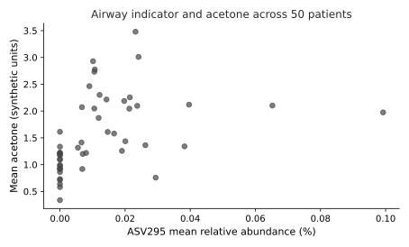

1. **Establish the indicator.** In `modules/indicator_analysis/tables/Type_Group_indicator_species_summary.tsv`, ASV295 (*Massilia*) has an airway-only assignment, indicator statistic 0.775 and adjusted p = 0.00127. That answers which site it characterizes.
2. **Read the patient points.** ASV295 occurred in 30 of 50 patients. The relative-abundance association with acetone was positive (Spearman ρ = 0.669, q = 0.0104). The points on the left include the 20 patients with zero abundance. This is an unadjusted between-patient association and cannot establish that *Massilia* produces acetone.
3. **Check sensitivity and selection.** The centered log-ratio (CLR) estimate was also positive (ρ = 0.690, q = 0.00973). This example was selected for having the largest positive relative-abundance ρ among airway indicators supported under both normalizations for acetone. In the saved run, 125 libraries from 50 patients supplied 167 candidate ASVs and six compounds. ASPIRE adjusts all 1,002 tested pairs together within each normalization. Selection makes this a discovery example requiring independent validation.

Display the table saved alongside your scatterplot. ASV identifiers can change between runs. A header with no data row means no pair met the selection criteria.

```bash
cd ~/aspire-vignette/study-figures
cat patient-isa-acetone.tsv
```

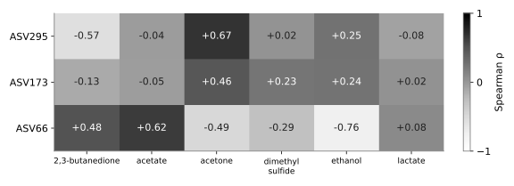

Read down the acetone column to compare positive and negative associations, then across each ASV to see whether the pattern extends to other compounds. Each cell shows relative-abundance ρ. Use the normalization comparison table for its q-value. The [sample-level clustermap](assets/vignette/asv_voc_clustermap.svg) shows individual libraries. In the separate sample-level truth check, six of 17 planted positive pairs reached the validator’s ρ threshold of 0.30. See [VOC statistics](VOC_STATISTICS.md) for the matching, permutation and multiple-testing procedures.
